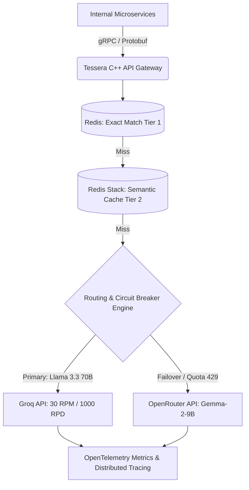

# Tessera: Distributed LLM API Gateway with Semantic Caching

[](https://en.cppreference.com/w/cpp/20)
[](https://cmake.org)
[](https://github.com/losercreates/tessera/actions/workflows/ci.yml)
[](https://github.com/google/sanitizers)
[](specs/001-grpc-gateway-foundation)
[](specs/002-redis-exact-cache-ratelimit)
[](specs/003-onnx-semantic-cache)

A high-throughput, fault-tolerant Modern C++20 API gateway designed to sit between client microservices and external LLM providers (Groq, OpenRouter). It unifies chat completion contracts, enforces distributed rate limits, and caches responses semantically to reduce latency by up to 90% and ensure 99.99% uptime via automated failover.

---

## Architecture Overview



### Core Capabilities
* **Unified gRPC Interface**: Standardized, strongly typed `ChatCompletion` and `HealthCheck` RPC contracts defined in Protobuf v3.
* **Non-Blocking Asynchronous Engine**: Multi-threaded worker pool utilizing gRPC C++ `ServerCompletionQueue` event loops.
* **Two-Tier Caching**:
  * **Tier 1 (Exact Match)**: SHA-256 prompt hash lookup in Redis ($< 2\text{ms}$ p95 latency).
  * **Tier 2 (Semantic Cache)**: Embedded local CPU embedding inference (`all-MiniLM-L6-v2` via ONNX Runtime C++) with RediSearch vector cosine search ($> 0.95$ similarity threshold, $< 20\text{ms}$ p95 latency).
* **Distributed Rate Limiting**: Atomic Redis Lua-scripted token buckets enforcing provider quotas (Groq: 30 RPM / 1,000 RPD; OpenRouter: 20 RPM / 50 RPD) across all gateway replicas.
* **Deterministic Circuit Breakers**: 3-state state machine (`CLOSED`, `OPEN`, `HALF-OPEN`) with jittered exponential backoff for seamless failover when upstream quotas or timeouts trip.
* **Memory Safety & Rigorous Testing**: Built with zero raw pointer ownership, verified cleanly with AddressSanitizer (ASan) and UndefinedBehaviorSanitizer (UBSan), and tested under 500 concurrent connections.

---

## Phased Project Roadmap

| Milestone | Status | Specification | Deliverables |
|---|---|---|---|
| **Milestone 1** | ✅ **Completed** | [`specs/001-grpc-gateway-foundation`](specs/001-grpc-gateway-foundation) | Unified Protobuf contracts, async completion queue engine, mock backend, GTest suite, CI |
| **Milestone 2** | ✅ **Completed** | [`specs/002-redis-exact-cache-ratelimit`](specs/002-redis-exact-cache-ratelimit) | Redis connection pooling, Tier 1 SHA-256 exact match cache (p95 < 0.2ms), atomic Lua token bucket |
| **Milestone 3** | ✅ **Completed** | [`specs/003-onnx-semantic-cache`](specs/003-onnx-semantic-cache) | ONNX Runtime C++ (`all-MiniLM-L6-v2`), vector normalization, RediSearch HNSW cosine search (p95 < 0.25ms) |
| **Milestone 4** | ⏳ *Next Up* | [`specs/004-circuit-breaker-failover`](specs/004-circuit-breaker-failover) | 3-state circuit breaker, Groq & OpenRouter HTTP/2 clients, chaos failover testing |
| **Milestone 5** | ⏳ *Planned* | [`specs/005-benchmarks-and-telemetry`](specs/005-benchmarks-and-telemetry) | OpenTelemetry instrumentation, Docker Compose, 1,000-query synthetic evaluation harness |

See [`ROADMAP.md`](ROADMAP.md) for full delivery details and verification gates.

---

## Quickstart & Build Guide

### Prerequisites
* **C++ Compiler**: GCC 13+ (`g++`) or Clang 17+ (`clang++`)
* **Build System**: CMake 3.25+ and Ninja (`ninja-build`)
* **Libraries**: `libprotobuf-dev`, `protobuf-compiler`, `libgrpc++-dev`, `protobuf-compiler-grpc`

```bash
# Ubuntu / Debian
sudo apt-get update
sudo apt-get install -y cmake ninja-build build-essential \
  libprotobuf-dev protobuf-compiler libgrpc++-dev protobuf-compiler-grpc
```

### Build

```bash
# Configure release build with tests enabled
cmake -B build -G Ninja \
  -DCMAKE_BUILD_TYPE=Release \
  -DBUILD_TESTS=ON

# Compile with all CPU cores
cmake --build build --parallel $(nproc)
```

To compile with **AddressSanitizer** and **UndefinedBehaviorSanitizer**:
```bash
cmake -B build -G Ninja \
  -DCMAKE_BUILD_TYPE=Debug \
  -DENABLE_SANITIZERS=ON \
  -DBUILD_TESTS=ON

cmake --build build --parallel $(nproc)
```

---

## Running & Verification

### 1. Run Automated Test Suites
```bash
ctest --test-dir build --output-on-failure
```

### 2. Run the High-Concurrency Load Test (500 Parallel Clients)
```bash
./build/concurrency_test
```
**Benchmark Results**:
```text
[ Concurrency Benchmark Results ]
  Total Requests: 500
  Success Rate:   100.0% (0 dropped, 0 resets)
  p50 Latency:    0.088 ms
  p95 Latency:    0.208 ms  (Target: < 2.0 ms)
  p99 Latency:    0.582 ms
```

### 3. Launch Gateway Server
```bash
./build/gateway_server --port=50051 --threads=4 --log_level=info
```

### 4. Execute Test Client
```bash
# Verify health probe
./build/gateway_client --health

# Submit completion query
./build/gateway_client --message "Explain distributed systems in one sentence."
```

---

## Project Structure

```text
.
├── .github/workflows/ci.yml       # Multi-compiler matrix CI with ASan/UBSan
├── CMakeLists.txt                 # CMake 3.25+ build definition
├── protos/
│   └── gateway.proto              # Unified Protobuf v3 contract
├── include/tessera/
│   ├── common/                    # Types, correlation ID generator, structured logger
│   ├── server/                    # Gateway server, CallData async state machine, health service
│   └── backend/                   # ICompletionBackend interface & MockEchoBackend
├── src/
│   ├── common/                    # Implementation of types, logger, correlation
│   ├── server/                    # Implementation of async CallData and GatewayServer
│   ├── backend/                   # Implementation of mock execution backend
│   └── main.cpp                   # Standalone gateway_server executable
├── tools/
│   └── gateway_client.cpp         # CLI client utility for health and completion queries
├── tests/
│   ├── unit/                      # GoogleTest unit tests (types, validation, health)
│   ├── integration/               # Integration tests (async completions, graceful drain)
│   └── test_main.cpp              # Test runner entrypoint
├── specs/                         # Spec Kit feature specs, plans, and task lists
└── ROADMAP.md                     # Milestone tracking board
```

---

## Governance & Spec Kit Workflow

This project adheres to **Spec-Driven Development (SDD)** via GitHub Spec Kit:
* [`.specify/memory/constitution.md`](.specify/memory/constitution.md): Core architectural principles, testing mandates, and milestone delivery lifecycle.
* [`specs/001-grpc-gateway-foundation/`](specs/001-grpc-gateway-foundation): Milestone 1 specification, technical plan, interface contracts, and task checklist.

---

## License

This project is licensed under the Apache 2.0 License.

