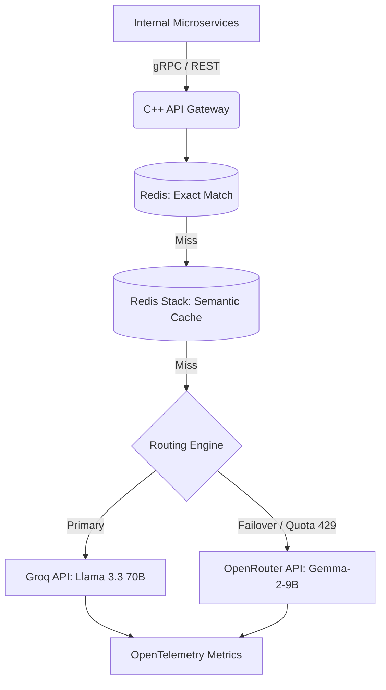

# Project Roadmap: Distributed LLM API Gateway with Semantic Caching

## Overview
A high-throughput, fault-tolerant C++20 API gateway sitting between client applications and external LLM providers. It routes requests, enforces distributed rate limits, and semantically caches responses to slash latency by up to 90% and ensure 99.99% availability via automated failover.

---

## System Architecture

---

## Milestone Delivery Board

| Milestone | Feature Directory | Focus Area | Deliverables & Gates | Status |
|---|---|---|---|---|
| **M1** | [`specs/001-grpc-gateway-foundation`](specs/001-grpc-gateway-foundation) | API & Async Ingestion | Unified Protobuf contracts, async gRPC CompletionQueue server, CMake 3.25+ build, GTest baseline, CI workflow | ⏳ Pending |
| **M2** | [`specs/002-redis-exact-cache-ratelimit`](specs/002-redis-exact-cache-ratelimit) | Exact Cache & Quotas | Redis connection pool, SHA-256 exact match cache (p95 < 2ms), atomic Lua distributed token bucket (Groq/OpenRouter limits) | ⏳ Pending |
| **M3** | [`specs/003-onnx-semantic-cache`](specs/003-onnx-semantic-cache) | Local Semantic Inference | Embedded ONNX Runtime C++ (`all-MiniLM-L6-v2`, 384-d), vector normalization, RediSearch HNSW cosine search (threshold > 0.95) | ⏳ Pending |
| **M4** | [`specs/004-circuit-breaker-failover`](specs/004-circuit-breaker-failover) | Resilience & Failover | 3-state Circuit Breaker (`CLOSED`, `OPEN`, `HALF-OPEN`), jittered backoff, Groq & OpenRouter clients, chaos mock outage tests | ⏳ Pending |
| **M5** | [`specs/005-benchmarks-and-telemetry`](specs/005-benchmarks-and-telemetry) | Evaluation & Production | OpenTelemetry metrics, Docker Compose environment, 1,000 synthetic query evaluation harness (30% paraphrased duplicates) | ⏳ Pending |

---

## Milestone Details

### Milestone 1 (M1): gRPC Gateway Foundation
- **Goals**: Establish the high-throughput asynchronous network runtime and API contracts.
- **Key Artifacts**: `protos/gateway.proto`, async worker thread pool, CMake build configuration, GoogleTest skeleton.
- **Verification Gate**: Concurrent gRPC client benchmark test; clean build with ASan/UBSan under GCC 13 and Clang 17.

### Milestone 2 (M2): Redis Exact Cache & Distributed Rate Limiter
- **Goals**: Implement Tier 1 exact-match caching and multi-replica rate limiting.
- **Key Artifacts**: Redis client wrapper, `rate_limiter.lua`, exact match cache manager with TTL eviction.
- **Verification Gate**: Integration test container validating sub-2ms cache hits and strict rate throttling under multi-threaded contention.

### Milestone 3 (M3): ONNX Semantic Cache & Vector Search
- **Goals**: Local CPU-based semantic similarity search without external embedding APIs.
- **Key Artifacts**: ONNX Runtime C++ model runner (`all-MiniLM-L6-v2`), C++ tokenizer, RediSearch vector index creator/querier.
- **Verification Gate**: Semantic similarity tests verifying paraphrased queries hit cache (< 20ms) with cosine similarity > 0.95.

### Milestone 4 (M4): Circuit Breaker & Multi-Provider Failover
- **Goals**: Resilient routing engine with automated failover and recovery.
- **Key Artifacts**: State machine `CircuitBreaker`, HTTP/2 client adapters for Groq and OpenRouter, jittered backoff.
- **Verification Gate**: Mock upstream chaos test injecting HTTP 429 quota exhaustion and verifying zero-loss failover to OpenRouter.

### Milestone 5 (M5): Telemetry, Benchmarks & Dockerization
- **Goals**: End-to-end evaluation, observability, and reproducible deployment.
- **Key Artifacts**: OpenTelemetry instrumentation, Docker Compose setup, synthetic benchmark script (1,000 queries).
- **Verification Gate**: Automated benchmark run confirming target p95 latency reductions and token cost savings under load.

