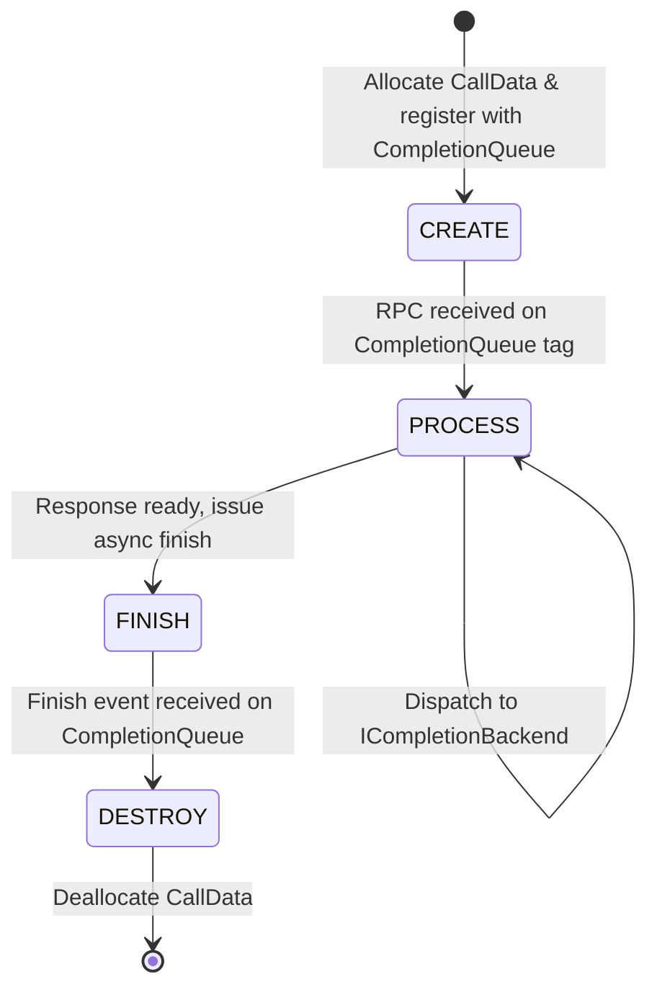

# Data Model: gRPC Gateway Foundation

**Feature**: `001-grpc-gateway-foundation`  
**Date**: 2026-11-01  
**Status**: Completed  

---

## Domain Entities & Schemas

### 1. `ChatMessage`
Represents an individual message turn within a conversation thread.

| Field | Type | Description | Validation Rules |
|---|---|---|---|
| `role` | `string` | The originator of the message | Must be one of: `"system"`, `"user"`, `"assistant"`, `"tool"` |
| `content` | `string` | Text content of the message | Must not be empty |
| `name` | `string` (optional) | Participant name / identifier | Max 64 characters |

---

### 2. `ChatCompletionRequest`
Inbound invocation payload submitted by client microservices.

| Field | Type | Description | Validation Rules |
|---|---|---|---|
| `model` | `string` | Requested model name (e.g., `llama-3.3-70b`, `gemma-2-9b`) | Non-empty string |
| `messages` | `repeated ChatMessage` | Ordered message history | Minimum 1 message required |
| `temperature` | `float` (optional) | Sampling temperature | Range: `[0.0, 2.0]`; default `1.0` |
| `max_tokens` | `uint32` (optional) | Maximum output tokens | Default `2048` |
| `stream` | `bool` | Stream tokens vs unary response | Default `false` |
| `correlation_id` | `string` (optional) | Tracing identifier | If empty, gateway auto-generates UUIDv4 |

---

### 3. `Choice`
An individual generated candidate completion.

| Field | Type | Description | Validation Rules |
|---|---|---|---|
| `index` | `uint32` | Candidate index | Zero-indexed |
| `message` | `ChatMessage` | The generated assistant message | Contains `role: "assistant"` |
| `finish_reason` | `string` | Termination reason | `"stop"`, `"length"`, or `"tool_calls"` |

---

### 4. `Usage`
Token consumption metrics for the completion.

| Field | Type | Description | Validation Rules |
|---|---|---|---|
| `prompt_tokens` | `uint32` | Input token count | $\ge 0$ |
| `completion_tokens` | `uint32` | Output token count | $\ge 0$ |
| `total_tokens` | `uint32` | Sum of prompt and completion | `prompt_tokens + completion_tokens` |

---

### 5. `ChatCompletionResponse`
Outbound payload returned to client applications.

| Field | Type | Description | Validation Rules |
|---|---|---|---|
| `id` | `string` | Unique completion ID | Prefixed with `chatcmpl-<uuid>` |
| `created` | `int64` | Unix timestamp (seconds) | Positive integer |
| `model` | `string` | Model identifier that generated the response | Non-empty string |
| `choices` | `repeated Choice` | Generated choices | Exactly 1 choice for unary completions |
| `usage` | `Usage` | Token usage summary | Valid `Usage` entity |
| `correlation_id` | `string` | Tracing correlation ID | Matches request correlation ID |

---

## Lifecycle & State Machine: `CallData`

Each incoming asynchronous RPC connection is managed by a lifecycle state machine:

* **`CREATE`**: Instantiates a new `CallData` instance and requests notification from gRPC when a new client invokes `ChatCompletion`.
* **`PROCESS`**: Spawns the next `CallData` listener (to ensure continuous readiness), validates incoming payload, attaches correlation ID, and invokes `ICompletionBackend::Complete()`.
* **`FINISH`**: Formats the `ChatCompletionResponse` and issues non-blocking `responder_.Finish()`.
* **`DESTROY`**: Handles clean RAII resource destruction upon completion.

