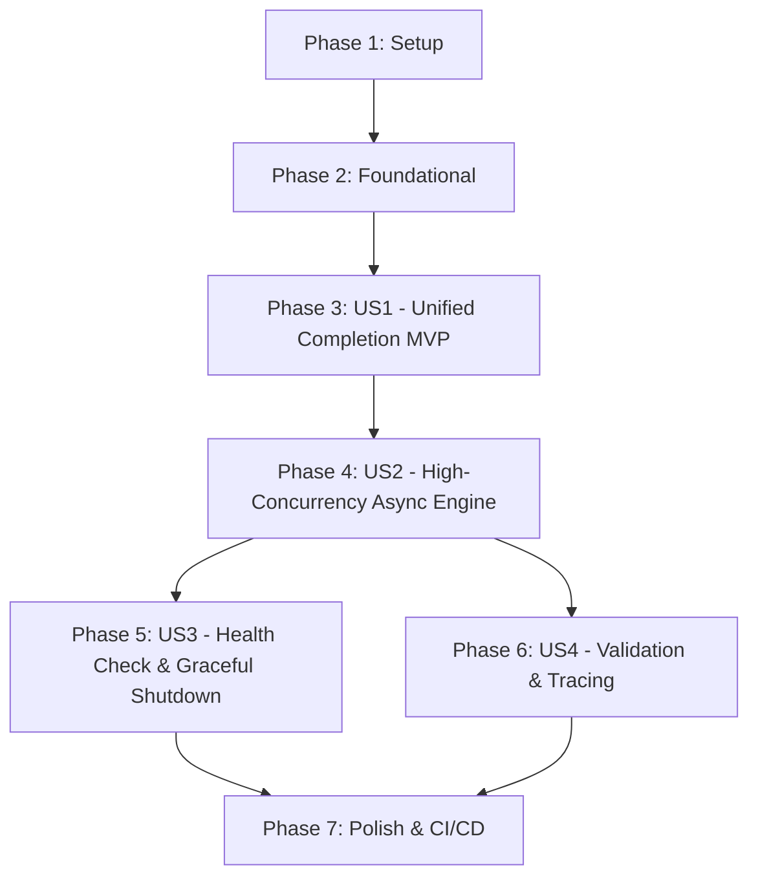

# Tasks: gRPC Gateway Foundation

**Input**: Design documents from `specs/001-grpc-gateway-foundation/`  
**Prerequisites**: `spec.md`, `plan.md`, `research.md`, `data-model.md`, `contracts/gateway.proto`  
**Tests**: Explicitly included per Constitution Principle IV (minimum 90% coverage, ASan/UBSan cleanliness) and user specification.  
**Organization**: Tasks are grouped by user story to enable independent implementation, testing, and delivery.

---

## Format: `[ID] [P?] [Story] Description`

- **[P]**: Can run in parallel (different files, no blocking dependencies)
- **[Story]**: User story identifier (`[US1]`, `[US2]`, `[US3]`, `[US4]`)
- Every task includes exact file paths

---

## Phase 1: Setup (Shared Infrastructure)

**Purpose**: Project directory layout, C++20 CMake build configuration, compiler sanitizers, and protobuf contract generation.

- [X] T001 [P] Create initial directory layout per plan.md in include/tessera/, src/, protos/, and tests/
- [X] T002 Configure CMake 3.25+ build system with C++20, Ninja generator, gRPC, Protobuf, and GoogleTest FetchContent in CMakeLists.txt
- [X] T003 [P] Configure compiler warning flags (-Wall -Wextra -Werror -pedantic) and ASan/UBSan sanitizer options in CMakeLists.txt
- [X] T004 [P] Copy contract schema into protos/gateway.proto for protoc gRPC C++ code generation

---

## Phase 2: Foundational (Blocking Prerequisites)

**Purpose**: Core primitives, interfaces, and mock execution backend required by all subsequent user stories.

**⚠️ CRITICAL**: No user story implementation can begin until this foundational phase is complete.

- [X] T005 Implement common error types and status mapping in include/tessera/common/types.hpp and src/common/types.cpp
- [X] T006 [P] Implement C++20 structured logger with format strings in include/tessera/common/logger.hpp and src/common/logger.cpp
- [X] T007 [P] Implement UUIDv4 correlation ID generator and header propagation utilities in include/tessera/common/correlation.hpp and src/common/correlation.cpp
- [X] T008 Implement ICompletionBackend abstract interface in include/tessera/backend/completion_backend.hpp
- [X] T009 Implement in-memory MockEchoBackend with token estimation in include/tessera/backend/mock_backend.hpp and src/backend/mock_backend.cpp
- [X] T010 Setup GoogleTest runner harness in tests/test_main.cpp and configure CTest targets in CMakeLists.txt

**Checkpoint**: Foundation ready. User story implementation can now begin.

---

## Phase 3: User Story 1 - Unified Chat Completion Ingestion (Priority: P1) 🎯 MVP

**Goal**: Deliver a functional gRPC ChatCompletion RPC endpoint processing requests asynchronously via the mock backend and returning formatted completions with usage metrics.

**Independent Test**: Client submits a valid `ChatCompletionRequest` over gRPC; gateway returns an affirmative `ChatCompletionResponse` with generated message, `id: chatcmpl-...`, and token usage counts.

### Tests for User Story 1
> *NOTE: Verify these tests compile and fail prior to finishing implementation.*

- [X] T011 [P] [US1] Unit test for ChatCompletionRequest validation and MockEchoBackend logic in tests/unit/test_mock_backend.cpp
- [X] T012 [P] [US1] Unit test for Protobuf serialization and response formatting in tests/unit/test_types.cpp

### Implementation for User Story 1

- [X] T013 [US1] Implement CallData state machine interface (CREATE, PROCESS, FINISH, DESTROY) in include/tessera/server/call_data.hpp
- [X] T014 [US1] Implement CallData execution logic invoking ICompletionBackend in src/server/call_data.cpp
- [X] T015 [US1] Implement async GatewayServer listener registering CallData with CompletionQueue in include/tessera/server/gateway_server.hpp and src/server/gateway_server.cpp
- [X] T016 [US1] Implement end-to-end gRPC client integration test verifying ChatCompletion in tests/integration/test_server_async.cpp

**Checkpoint**: User Story 1 (MVP) is fully functional and independently testable.

---

## Phase 4: User Story 2 - High-Concurrency Asynchronous Request Processing (Priority: P1)

**Goal**: Enable high-throughput processing capable of servicing $\ge 500$ concurrent requests across a thread pool using non-blocking CompletionQueue workers without connection drops.

**Independent Test**: Concurrency test harness spawns 500 parallel client threads issuing requests simultaneously; all requests succeed with 0 connection drops and p95 overhead $< 2\text{ms}$.

### Tests for User Story 2

- [X] T017 [P] [US2] Implement high-concurrency stress test with 500 parallel worker threads in tests/integration/test_concurrency.cpp

### Implementation for User Story 2

- [X] T018 [US2] Implement multi-threaded CompletionQueue worker pool in src/server/gateway_server.cpp
- [X] T019 [P] [US2] Implement server configuration parameters (port, worker threads, queue count) in include/tessera/server/server_config.hpp
- [X] T020 [US2] Implement standalone gateway executable entrypoint in src/main.cpp

**Checkpoint**: User Stories 1 and 2 operate concurrently with verified thread safety and high throughput.

---

## Phase 5: User Story 3 - Health Checking & Graceful Shutdown (Priority: P2)

**Goal**: Expose a standard RPC health checking probe (`SERVING`/`NOT_SERVING`) and implement signal-based graceful connection draining upon SIGTERM/SIGINT.

**Independent Test**: Health check probe returns `SERVING`, and issuing a shutdown signal during in-flight requests allows all active requests to complete within the 5s grace period before exiting cleanly with code 0.

### Tests for User Story 3

- [X] T021 [P] [US3] Unit test for HealthCheck RPC and serving status transitions in tests/unit/test_health_check.cpp
- [X] T022 [P] [US3] Implement integration test verifying graceful shutdown while requests are in-flight in tests/integration/test_graceful_shutdown.cpp

### Implementation for User Story 3

- [X] T023 [US3] Implement HealthCheck CallData handler and status registry in include/tessera/server/health_service.hpp and src/server/health_service.cpp
- [X] T024 [US3] Implement POSIX signal handling (SIGINT, SIGTERM) and graceful draining loop with configurable timeout in src/server/gateway_server.cpp

**Checkpoint**: Health checking and graceful termination operate reliably for containerized environments.

---

## Phase 6: User Story 4 - Request Validation & Correlation Tracing (Priority: P2)

**Goal**: Enforce strict request validation (messages not empty, role must be one of `"system"`, `"user"`, `"assistant"`, `"tool"`), limit payload size to 4MB, and echo correlation IDs.

**Independent Test**: Submit invalid requests (missing messages or payload > 4MB); server rejects with `INVALID_ARGUMENT` or `RESOURCE_EXHAUSTED` in $< 1\text{ms}$, and echoes correlation IDs on valid requests.

### Tests for User Story 4

- [X] T025 [P] [US4] Unit test for schema constraints (role enum validation, non-empty content) and correlation ID generation in tests/unit/test_validation.cpp
- [X] T026 [P] [US4] Implement integration test verifying invalid request rejection and correlation ID echo in tests/integration/test_validation_integration.cpp

### Implementation for User Story 4

- [X] T027 [US4] Implement request validator enforcing role must be one of 'system', 'user', 'assistant', 'tool' and content not empty in src/server/call_data.cpp
- [X] T028 [US4] Configure gRPC ChannelArguments for max message size (4MB limit) in src/server/gateway_server.cpp

**Checkpoint**: All four user stories complete, validated, and integrated.

---

## Phase 7: Polish & Cross-Cutting Concerns

**Purpose**: CI/CD automation, sanitizer validation, and end-to-end documentation verification.

- [X] T029 [P] Create GitHub Actions CI workflow in .github/workflows/ci.yml with GCC 13, Clang 17, and ASan/UBSan matrix
- [X] T030 [P] Implement standalone test client utility in tools/gateway_client.cpp for manual verification
- [X] T031 [P] Run quickstart.md validation script and document output in specs/001-grpc-gateway-foundation/quickstart.md
- [X] T032 Verify AddressSanitizer and UndefinedBehaviorSanitizer pass cleanly across all test targets

---

## Dependencies & Execution Order

### Phase Dependencies



- **Setup (Phase 1)**: Independent, starts immediately.
- **Foundational (Phase 2)**: Depends on Setup. Blocks all user stories.
- **User Story 1 (Phase 3 - MVP)**: Depends on Foundational. Delivers core functional baseline.
- **User Story 2 (Phase 4)**: Extends US1 with multi-threaded completion queues.
- **User Story 3 & 4 (Phases 5 & 6)**: Can proceed in parallel once US2 is in place.
- **Polish (Phase 7)**: Final quality gate across the completed milestone.

---

## Parallel Opportunities

```bash
# Setup tasks that can execute in parallel:
Task T001: "Create initial directory layout in include/tessera/, src/, protos/, tests/"
Task T003: "Configure compiler warning flags and sanitizers in CMakeLists.txt"
Task T004: "Copy contract schema into protos/gateway.proto"

# Foundational tasks that can execute in parallel:
Task T006: "Implement C++20 structured logger in include/tessera/common/logger.hpp"
Task T007: "Implement UUIDv4 correlation ID generator in include/tessera/common/correlation.hpp"

# User Story 1 tests that can execute in parallel:
Task T011: "Unit test for ChatCompletionRequest validation in tests/unit/test_mock_backend.cpp"
Task T012: "Unit test for Protobuf serialization in tests/unit/test_types.cpp"
```

---

## Implementation Strategy

### MVP First (Phases 1, 2 & 3)
1. Complete Phase 1 (Setup) and Phase 2 (Foundational).
2. Implement Phase 3 (User Story 1).
3. **STOP and VALIDATE**: Verify unary ChatCompletion works end-to-end against `MockEchoBackend`.

### Full Milestone Delivery (Phases 4, 5, 6 & 7)
4. Implement multi-threaded CompletionQueue worker pool (User Story 2) and verify 500-client load test.
5. Add health checks and graceful shutdown (User Story 3).
6. Enforce 4MB payload limits and validation constraints (User Story 4).
7. Deploy GitHub Actions CI workflow and confirm ASan/UBSan cleanliness.

