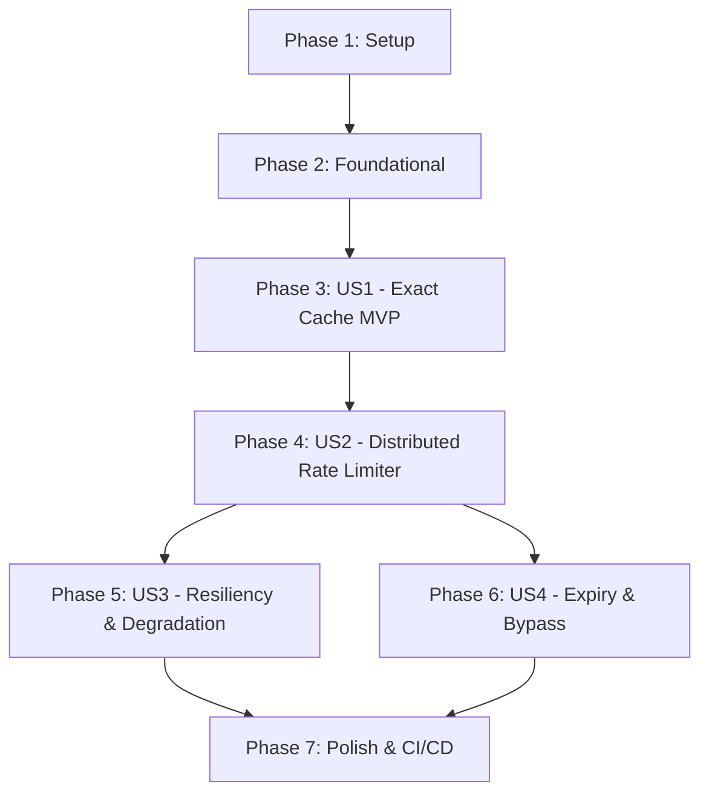

# Tasks: Redis Exact-Match Cache & Distributed Rate Limiting

**Input**: Design documents from `specs/002-redis-exact-cache-ratelimit/`  
**Prerequisites**: `spec.md`, `plan.md`, `research.md`, `data-model.md`, `contracts/rate_limiter.lua`  
**Tests**: Explicitly included per Constitution Principle IV ($\ge 90\%$ test coverage, ASan/UBSan clean).  
**Organization**: Tasks are grouped by user story to enable independent implementation, testing, and delivery.

---

## Format: `[ID] [P?] [Story] Description`

- **[P]**: Can run in parallel (different files, no blocking dependencies)
- **[Story]**: User story identifier (`[US1]`, `[US2]`, `[US3]`, `[US4]`)
- Every task includes exact file paths

---

## Phase 1: Setup (Shared Infrastructure)

**Purpose**: Create directory structures, configure OpenSSL/Redis build dependencies, and embed Lua contracts.

- [X] T001 [P] Create cache and ratelimit directories in include/tessera/cache/, include/tessera/ratelimit/, src/cache/, and src/ratelimit/
- [X] T002 Configure OpenSSL and Redis client library dependencies in CMakeLists.txt
- [X] T003 [P] Copy production Lua script into src/ratelimit/scripts/rate_limiter.lua and embed into C++ binary

---

## Phase 2: Foundational (Blocking Prerequisites)

**Purpose**: Core hashing, Redis client abstraction, connection pool, and token bucket data models.

**⚠️ CRITICAL**: No user story implementation can begin until this foundational phase is complete.

- [X] T004 Implement deterministic SHA-256 canonical prompt hashing in include/tessera/cache/sha256.hpp and src/cache/sha256.cpp
- [X] T005 [P] Implement IRedisClient interface and in-memory MockRedisClient in include/tessera/cache/redis_client.hpp and src/cache/redis_client.cpp
- [X] T006 Implement thread-safe RedisConnectionPool with health probing in include/tessera/cache/redis_pool.hpp and src/cache/redis_pool.cpp
- [X] T007 [P] Implement TokenBucket math and RateLimitRule in include/tessera/ratelimit/token_bucket.hpp and src/ratelimit/token_bucket.cpp

**Checkpoint**: Foundation ready. User story implementation can now begin.

---

## Phase 3: User Story 1 - Exact-Match Caching for Identical Queries (Priority: P1) 🎯 MVP

**Goal**: Identical prompts return cached responses from Redis in $< 2\text{ms}$ with `cache_hit: true` and `tier: "exact"`, eliminating redundant upstream LLM calls.

**Independent Test**: Submit a prompt, verify response is stored in Redis; submit identical prompt and verify response returns in $< 2\text{ms}$ without invoking inner backend.

### Tests for User Story 1
> *NOTE: Verify these tests compile and fail prior to finishing implementation.*

- [X] T008 [P] [US1] Unit test for SHA-256 prompt canonicalization and key generation in tests/unit/test_sha256.cpp
- [X] T009 [P] [US1] Unit test for ExactCacheService hit/miss and JSON serialization in tests/unit/test_exact_cache.cpp

### Implementation for User Story 1

- [X] T010 [US1] Implement ExactCacheService with Redis GET/SETEX operations in include/tessera/cache/exact_cache.hpp and src/cache/exact_cache.cpp
- [X] T011 [US1] Implement CachedCompletionBackend decorator wrapping ICompletionBackend in include/tessera/cache/cached_backend.hpp and src/cache/cached_backend.cpp
- [X] T012 [US1] Integration test verifying sub-2ms exact cache hits against Redis in tests/integration/test_redis_integration.cpp

**Checkpoint**: User Story 1 (Exact-Match Caching MVP) is fully functional and independently testable.

---

## Phase 4: User Story 2 - Distributed Token Bucket Rate Limiting (Priority: P1)

**Goal**: Atomic server-side Redis Lua rate limiting enforcing Groq (30 RPM / 1000 RPD) and OpenRouter (20 RPM / 50 RPD) quotas across all replicas.

**Independent Test**: Run 200 concurrent threads simulating requests across instances; verify exactly allowed quota passes (30 RPM) and excess requests receive `RESOURCE_EXHAUSTED` with accurate retry-after seconds.

### Tests for User Story 2

- [X] T013 [P] [US2] Unit test for Lua rate limiter script execution and refill calculation in tests/unit/test_rate_limiter.cpp
- [X] T014 [P] [US2] High-concurrency 200-thread rate limit stress test in tests/integration/test_ratelimit_concurrency.cpp

### Implementation for User Story 2

- [X] T015 [US2] Implement DistributedRateLimiter class executing rate_limiter.lua in include/tessera/ratelimit/rate_limiter.hpp and src/ratelimit/rate_limiter.cpp
- [X] T016 [US2] Implement RateLimitedBackend decorator enforcing provider quotas in include/tessera/ratelimit/rate_limited_backend.hpp and src/ratelimit/rate_limited_backend.cpp
- [X] T017 [US2] Integrate rate limiter and exact cache into gateway_server and gateway_client CLI tools

**Checkpoint**: User Stories 1 and 2 operate concurrently with verified thread safety, sub-2ms cache hits, and atomic rate limiting.

---

## Phase 5: User Story 3 - Redis Connection Resiliency & Graceful Degradation (Priority: P2)

**Goal**: Gateway fails open when Redis is unreachable, continuing to serve requests via backend with zero dropped client calls.

**Independent Test**: Partition or stop Redis during active traffic; verify gateway logs warnings and transparently passes requests through to inner backend without failure.

### Tests for User Story 3

- [X] T018 [P] [US3] Unit test for RedisConnectionPool health tracking and reconnect backoff in tests/unit/test_redis_pool.cpp
- [X] T019 [P] [US3] Integration test verifying fail-open cache degradation when Redis disconnects in tests/integration/test_redis_resilience.cpp

### Implementation for User Story 3

- [X] T020 [US3] Implement health detection and fail-open policy in CachedCompletionBackend in src/cache/cached_backend.cpp

**Checkpoint**: Cache degradation operates safely without cascading outages.

---

## Phase 6: User Story 4 - Cache Expiry & Selective Bypass (Priority: P2)

**Goal**: Support configurable cache TTL (default 86400s) and per-request `no_cache = true` bypass directive.

**Independent Test**: Send request with `no_cache = true` on cached prompt; verify cache read is bypassed, fresh completion is generated, and cache entry is refreshed.

### Tests for User Story 4

- [X] T021 [P] [US4] Unit test for cache entry TTL expiration and no_cache bypass flag in tests/unit/test_cache_bypass.cpp

### Implementation for User Story 4

- [X] T022 [US4] Add no_cache field to ChatCompletionRequest and implement bypass logic in src/cache/cached_backend.cpp
- [X] T023 [US4] Expose --no-cache and --cache-ttl CLI options in tools/gateway_client.cpp and src/main.cpp

**Checkpoint**: All four user stories complete, validated, and integrated.

---

## Phase 7: Polish & CI/CD Concerns

**Purpose**: CI/CD automation, performance benchmarking, and sanitizer validation.

- [X] T024 [P] Update GitHub Actions CI in .github/workflows/ci.yml with Redis service container
- [X] T025 [P] Implement cache benchmark tool in tools/cache_benchmark.cpp measuring p95 cache hit latency
- [X] T026 [P] Update quickstart.md validation script and document output in specs/002-redis-exact-cache-ratelimit/quickstart.md
- [X] T027 Verify AddressSanitizer and UndefinedBehaviorSanitizer pass cleanly across all Milestone 2 targets

---

## Dependencies & Execution Order

### Phase Dependencies

