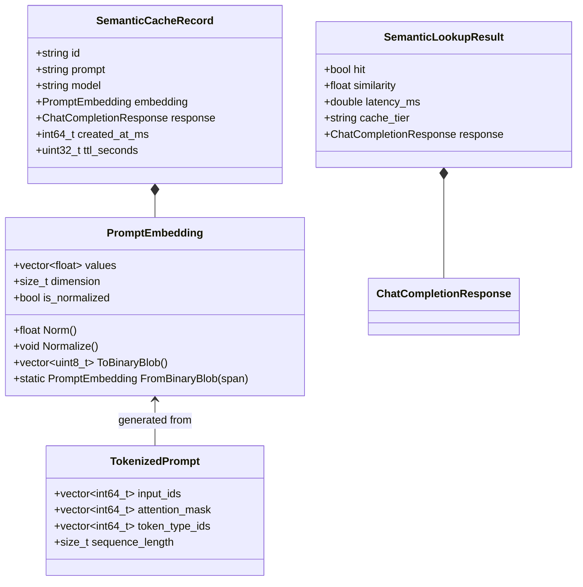

# Data Model: Local ONNX Semantic Cache & Vector Search

**Feature**: `003-onnx-semantic-cache`  
**Date**: 2026-11-03  
**Status**: Completed  

---

## 1. Domain Entities & Memory Structures



---

## 2. Entity Field Specifications

### 2.1. `PromptEmbedding`
Represents the 384-dimensional dense semantic vector representation of a prompt.

| Field | Type | Description |
|---|---|---|
| `values` | `std::vector<float>` | Exactly 384 float values produced by model inference. |
| `dimension` | `size_t` | Constant 384. |
| `is_normalized` | `bool` | True if Euclidean L2 norm is $1.0 \pm 10^{-5}$. |

- **Binary Serialization Format**: Contiguous IEEE 754 32-bit little-endian floats ($384 \times 4 = 1,536$ bytes), directly compatible with RediSearch vector BLOB parameters.

### 2.2. `TokenizedPrompt`
Intermediate subword representation fed into the ONNX Runtime model.

| Field | Type | Description |
|---|---|---|
| `input_ids` | `std::vector<int64_t>` | Token identifiers from WordPiece vocabulary (includes `[CLS]` 101, `[SEP]` 102). |
| `attention_mask` | `std::vector<int64_t>` | 1 for active tokens, 0 for padding tokens. |
| `token_type_ids` | `std::vector<int64_t>` | All zeros (single-sequence sentence embedding). |
| `sequence_length` | `size_t` | Padded length, default 128. |

### 2.3. `SemanticCacheRecord`
Full record stored in Redis Stack and indexed by RediSearch.

| Field | Type | Storage Type | Description |
|---|---|---|---|
| `id` | `std::string` | Hash Key | Key: `cache:semantic:<uuid>`. |
| `prompt` | `std::string` | TEXT | Canonical prompt string. |
| `model` | `std::string` | TAG | Upstream model identifier (e.g. `llama-3.3-70b-versatile`). |
| `vector` | `PromptEmbedding` | VECTOR | 1,536-byte raw binary blob indexed by HNSW. |
| `response` | `std::string` | TEXT | Serialized JSON `ChatCompletionResponse`. |
| `created_at_ms` | `int64_t` | NUMERIC | Epoch timestamp in milliseconds. |
| `ttl_seconds` | `uint32_t` | TTL | Redis expiration TTL. |

---

## 3. Storage & Index Schemas

### 3.1. RediSearch Index Specification (`idx:semantic_cache`)

```text
FT.CREATE idx:semantic_cache
    ON HASH
    PREFIX 1 cache:semantic:
    SCHEMA
        prompt TEXT NOSTEM
        model TAG
        vector VECTOR HNSW 6
            TYPE FLOAT32
            DIM 384
            DISTANCE_METRIC COSINE
            M 16
            EF_CONSTRUCTION 200
        response TEXT NOSTEM
        created_at_ms NUMERIC
```

### 3.2. Two-Tier Key Namespace Separation

```text
Redis Database Namespace:
├── cache:exact:<sha256_hex>      -> STRING (JSON completion, TTL set)
└── cache:semantic:<uuid>         -> HASH (fields: prompt, model, vector, response, created_at_ms)
```

