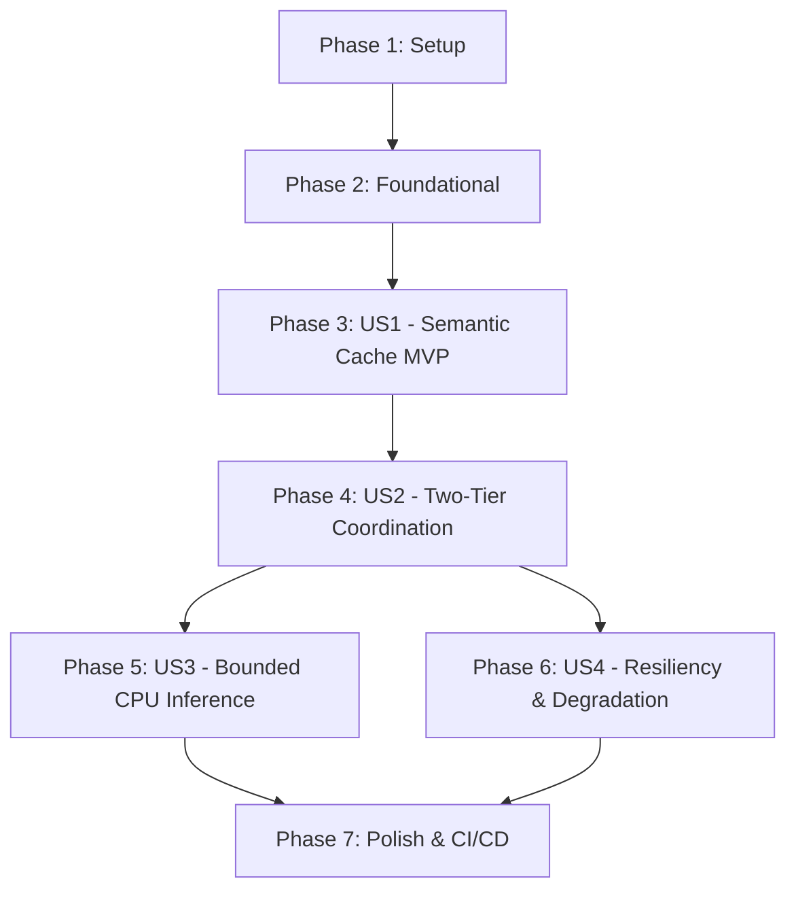

# Tasks: Local ONNX Semantic Cache & Vector Search

**Input**: Design documents from `specs/003-onnx-semantic-cache/`  
**Prerequisites**: `spec.md`, `plan.md`, `research.md`, `data-model.md`, `contracts/semantic_cache_contract.md`  
**Tests**: Explicitly included per Constitution Principle IV ($\ge 90\%$ test coverage, ASan/UBSan clean).  
**Organization**: Tasks are grouped by user story to enable independent implementation, testing, and delivery.

---

## Format: `[ID] [P?] [Story] Description`

- **[P]**: Can run in parallel (different files, no blocking dependencies)
- **[Story]**: User story identifier (`[US1]`, `[US2]`, `[US3]`, `[US4]`)
- Every task includes exact file paths

---

## Phase 1: Setup (Shared Infrastructure)

**Purpose**: Create directory structures, configure ONNX Runtime/math dependencies in CMake, and configure tokenizer fixtures.

- [X] T001 [P] Create semantic cache directories in include/tessera/cache/, src/cache/, and tests/unit/
- [X] T002 Configure ONNX Runtime and math library build dependencies in CMakeLists.txt
- [X] T003 [P] Add WordPiece vocabulary fixtures and embedding test vectors in tests/fixtures/vocab.txt

---

## Phase 2: Foundational (Blocking Prerequisites)

**Purpose**: Core tokenizer, PromptEmbedding mathematical structures, IEmbeddingEngine, and ISemanticCacheStore abstractions.

**⚠️ CRITICAL**: No user story implementation can begin until this foundational phase is complete.

- [X] T004 Implement WordPiece BertTokenizer with subword segmentation and context truncation in include/tessera/cache/embedding_engine.hpp and src/cache/embedding_engine.cpp
- [X] T005 [P] Implement PromptEmbedding struct with L2 unit normalization and binary BLOB serialization in include/tessera/cache/embedding_engine.hpp and src/cache/embedding_engine.cpp
- [X] T006 Implement IEmbeddingEngine interface and OnnxEmbeddingEngine / MockEmbeddingEngine in include/tessera/cache/onnx_embedding.hpp and src/cache/onnx_embedding.cpp
- [X] T007 [P] Implement ISemanticCacheStore interface and thread-safe MockVectorIndex in include/tessera/cache/vector_store.hpp and src/cache/vector_store.cpp

**Checkpoint**: Foundation ready. User story implementation can now begin.

---

## Phase 3: User Story 1 - Semantic Cache Retrieval for Paraphrased Queries (Priority: P1) 🎯 MVP

**Goal**: Paraphrased queries with cosine similarity $\ge 0.95$ return cached responses in $< 20\text{ms}$ with `cache_hit: true` and `tier: "semantic"`.

**Independent Test**: Prime the cache with an initial prompt, submit a paraphrased variant, and verify the response returns in $< 20\text{ms}$ from Tier 2 without invoking upstream providers.

### Tests for User Story 1
> *NOTE: Verify these tests compile and fail prior to finishing implementation.*

- [X] T008 [P] [US1] Unit test for WordPiece tokenization, [CLS]/[SEP] encoding, and 512-token truncation in tests/unit/test_tokenizer.cpp
- [X] T009 [P] [US1] Unit test for cosine vector distance calculation and similarity thresholding (0.95 boundary) in tests/unit/test_vector_store.cpp

### Implementation for User Story 1

- [X] T010 [US1] Implement RediSearchVectorStore with FT.CREATE and FT.SEARCH KNN commands in include/tessera/cache/vector_store.hpp and src/cache/vector_store.cpp
- [X] T011 [US1] Implement SemanticCacheService with top-1 vector search and response deserialization in include/tessera/cache/semantic_cache.hpp and src/cache/semantic_cache.cpp
- [X] T012 [US1] Integration test verifying sub-20ms semantic cache hits on paraphrased queries in tests/integration/test_semantic_integration.cpp

**Checkpoint**: User Story 1 (Semantic Cache Retrieval MVP) is fully functional and independently testable.

---

## Phase 4: User Story 2 - Two-Tier Hierarchical Cache Coordination (Priority: P1)

**Goal**: Tier 1 exact-match cache (< 2ms) is checked first; Tier 2 semantic search (< 20ms) is only evaluated on Tier 1 miss. Successful upstream completions are indexed into both tiers.

**Independent Test**: Submit exact duplicate prompt (verify Tier 1 hit, 0 embedding compute); submit paraphrase (verify Tier 2 hit); submit novel prompt (verify miss on both, upstream invocation, and dual indexing).

### Tests for User Story 2

- [X] T013 [P] [US2] Unit test verifying TwoTierCacheService bypasses Tier 2 embedding inference on Tier 1 hit in tests/unit/test_two_tier_cache.cpp
- [X] T014 [P] [US2] Unit test verifying TwoTierCacheService populates both Tier 1 and Tier 2 on upstream completion in tests/unit/test_two_tier_cache.cpp

### Implementation for User Story 2

- [X] T015 [US2] Implement TwoTierCacheService coordinating ExactCacheService and SemanticCacheService in include/tessera/cache/two_tier_cache.hpp and src/cache/two_tier_cache.cpp
- [X] T016 [US2] Update CachedCompletionBackend to wrap TwoTierCacheService in include/tessera/cache/cached_backend.hpp and src/cache/cached_backend.cpp
- [X] T017 [US2] Integrate TwoTierCacheService into gateway_server and gateway_client CLI tools

**Checkpoint**: User Stories 1 and 2 operate concurrently with verified thread safety, sub-2ms exact hits, and sub-20ms semantic hits.

---

## Phase 5: User Story 3 - Local CPU Embedding Inference with Bounded Memory (Priority: P2)

**Goal**: Local CPU embedding inference without external network calls, keeping total memory footprint strictly below 500MB RAM.

**Independent Test**: Execute 1,000 embedding inference calls; verify dense 384-d outputs with unit L2 norm and resident memory remaining $< 500\text{MB}$.

### Tests for User Story 3

- [X] T018 [P] [US3] Unit test for 384-dimensional embedding generation and unit norm validation in tests/unit/test_embedding.cpp
- [X] T019 [P] [US3] Memory footprint and resource bounding test across continuous inference in tests/unit/test_embedding.cpp

### Implementation for User Story 3

- [X] T020 [US3] Optimize tensor memory allocations, buffer reuse, and session threading options in src/cache/onnx_embedding.cpp

**Checkpoint**: Local CPU inference operates deterministically within bounded memory limits.

---

## Phase 6: User Story 4 - Semantic Cache Degradation, Selective Bypass & TTL Expiry (Priority: P2)

**Goal**: Support per-request `--no-cache` bypass, configurable TTL on semantic cache entries, and transparent fail-open degradation if RediSearch is down.

**Independent Test**: Issue query with `no_cache = true` on cached prompt; simulate vector store outage; verify zero dropped client calls and proper TTL eviction.

### Tests for User Story 4

- [X] T021 [P] [US4] Integration test verifying fail-open degradation when RediSearch is disconnected in tests/integration/test_semantic_resilience.cpp
- [X] T022 [P] [US4] Unit test verifying no_cache flag bypasses both Tier 1 and Tier 2 read lookups in tests/unit/test_two_tier_cache.cpp

### Implementation for User Story 4

- [X] T023 [US4] Implement TTL expiration handling and fail-open fallback logic in src/cache/two_tier_cache.cpp
- [X] T024 [US4] Expose semantic cache metrics and --semantic-cache CLI options in tools/gateway_client.cpp and src/main.cpp

**Checkpoint**: All four user stories complete, validated, and integrated.

---

## Phase 7: Polish & CI/CD Concerns

**Purpose**: CI/CD automation, performance benchmarking, and sanitizer validation.

- [X] T025 [P] Update GitHub Actions CI in .github/workflows/ci.yml with RediSearch vector tests
- [X] T026 [P] Implement semantic cache benchmark tool in tools/semantic_benchmark.cpp measuring p95 latency on paraphrased queries
- [X] T027 [P] Update quickstart.md validation script and document output in specs/003-onnx-semantic-cache/quickstart.md
- [X] T028 Verify AddressSanitizer and UndefinedBehaviorSanitizer pass cleanly across all Milestone 3 targets

---

## Dependencies & Execution Order

### Phase Dependencies

### User Story Dependencies

- **User Story 1 (P1)**: Depends on Phase 2 (Foundational). Delivers independent MVP semantic search.
- **User Story 2 (P1)**: Depends on US1 and Tier 1 ExactCacheService. Delivers unified two-tier hierarchy.
- **User Story 3 (P2)**: Depends on US1. Optimizes ONNX CPU runtime and memory bounding.
- **User Story 4 (P2)**: Depends on US2. Enforces fail-open degradation and selective cache bypass.

---

## Implementation Strategy

### MVP First (User Story 1 Only)
1. Complete Phase 1: Setup
2. Complete Phase 2: Foundational (Tokenizer, Embedding Math, Vector Store interface)
3. Complete Phase 3: User Story 1 (Semantic Cache Retrieval)
4. **STOP and VALIDATE**: Test semantic cache hit on paraphrased query with similarity $\ge 0.95$.

### Incremental Delivery
1. Add User Story 2: Two-tier cache coordination (Tier 1 exact checked before Tier 2).
2. Add User Story 3: Memory optimization and resource profiling.
3. Add User Story 4: Fail-open resiliency, TTL expiry, and `--no-cache` bypass.
4. Run full test suite with ASan and UBSan sanitizers enabled.
