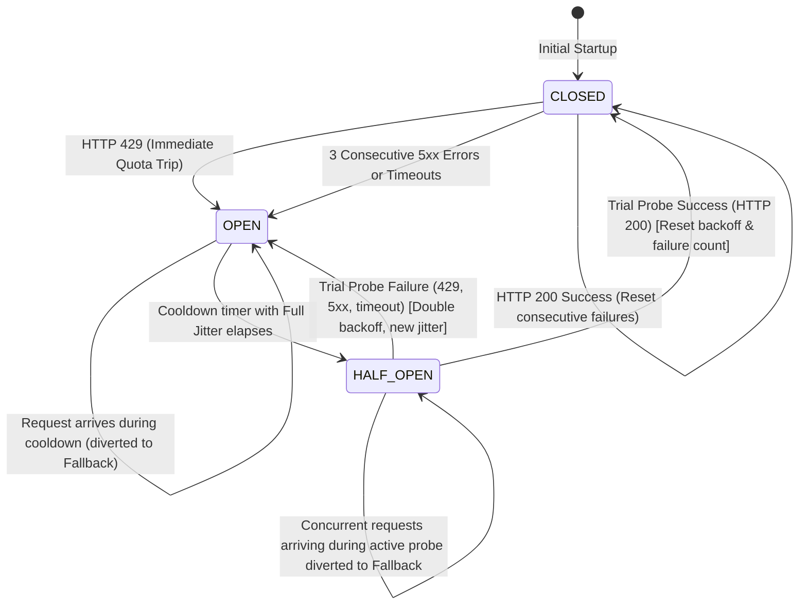

# Data Model: Circuit Breaker & Multi-Provider Failover

**Feature Branch**: `004-circuit-breaker-failover`  
**Date**: 2026-11-04  
**Status**: Completed  

---

## 1. Entities & Data Structures

### 1.1 `CircuitState` (Enum)
Represents the operational availability of an upstream provider.

```cpp
namespace tessera {

enum class CircuitState : uint8_t {
  CLOSED = 0,     // Normal healthy state. Requests pass through.
  OPEN = 1,       // Tripped state. Requests are rejected or diverted to fallback.
  HALF_OPEN = 2   // Trial recovery state. Exactly one probe request is permitted.
};

[[nodiscard]] constexpr std::string_view ToString(CircuitState state) noexcept {
  switch (state) {
    case CircuitState::CLOSED: return "CLOSED";
    case CircuitState::OPEN: return "OPEN";
    case CircuitState::HALF_OPEN: return "HALF-OPEN";
  }
  return "UNKNOWN";
}

}  // namespace tessera
```

---

### 1.2 `CircuitBreakerConfig` (Struct)
Configuration parameters governing failure thresholds, backoff ceilings, and timeouts.

| Field | Type | Default | Description | Validation Rules |
|---|---|---|---|---|
| `consecutive_failure_threshold` | `uint32_t` | `3` | Number of consecutive 5xx/timeout errors to trip circuit | Must be $\ge 1$ |
| `base_cooldown_ms` | `uint32_t` | `1000` | Initial backoff cooldown window in milliseconds | Must be $\ge 100$ |
| `max_cooldown_ms` | `uint32_t` | `60000` | Maximum truncated backoff ceiling in milliseconds | Must be $\ge \text{base\_cooldown\_ms}$ |
| `request_timeout_ms` | `uint32_t` | `10000` | Upstream socket and request execution timeout | Must be $\ge 500$ |
| `trip_on_429` | `bool` | `true` | Whether HTTP 429 trips circuit immediately on 1st occurrence | Must be `true` (Constitution Mandate) |

---

### 1.3 `CircuitBreakerStats` (Struct)
Real-time telemetry and operational metrics for an upstream provider circuit breaker.

| Field | Type | Description |
|---|---|---|
| `current_state` | `CircuitState` | Active circuit state (`CLOSED`, `OPEN`, `HALF_OPEN`) |
| `total_requests` | `uint64_t` | Total requests processed by this circuit |
| `successful_requests` | `uint64_t` | Total requests that succeeded (HTTP 200) |
| `failed_requests` | `uint64_t` | Total requests that returned errors or timed out |
| `rejected_requests` | `uint64_t` | Total requests diverted or rejected due to `OPEN` state |
| `consecutive_failures` | `uint32_t` | Current streak of consecutive failures |
| `trip_count` | `uint32_t` | Total number of times this circuit transitioned to `OPEN` |
| `recovery_count` | `uint32_t` | Total number of times this circuit recovered to `CLOSED` |
| `current_cooldown_ms` | `uint64_t` | Remaining or calculated cooldown time in ms |

---

### 1.4 `UpstreamRequest` & `UpstreamResponse` (Structs)
Domain models representing the normalized payload exchanged with external LLM providers.

```cpp
struct UpstreamRequest {
  std::string provider;                                // e.g., "groq", "openrouter"
  std::string model;                                   // e.g., "llama-3.3-70b-versatile", "google/gemma-2-9b-it"
  std::vector<ChatMessage> messages;                   // System, user, assistant messages
  float temperature = 0.7f;
  uint32_t max_tokens = 1024;
  std::string correlation_id;
  std::unordered_map<std::string, std::string> headers;
  std::chrono::milliseconds timeout{10000};
};

struct UpstreamResponse {
  int status_code = 0;                                 // HTTP status: 200, 429, 500, 503, 0 (timeout)
  std::string body;                                    // Raw response body
  std::string completion_text;                         // Extracted completion text
  std::string model;                                   // Model reported in response
  uint32_t prompt_tokens = 0;
  uint32_t completion_tokens = 0;
  uint32_t total_tokens = 0;
  double latency_ms = 0.0;
  std::string error_message;

  [[nodiscard]] bool IsSuccess() const noexcept {
    return status_code >= 200 && status_code < 300;
  }
  [[nodiscard]] bool IsRateLimited() const noexcept {
    return status_code == 429;
  }
  [[nodiscard]] bool IsServerError() const noexcept {
    return status_code >= 500 || status_code == 0;
  }
};
```

---

### 1.5 `UpstreamProviderConfig` (Struct)
Defines an external provider endpoint, credentials, and associated circuit breaker parameters.

| Field | Type | Default | Description |
|---|---|---|---|
| `name` | `std::string` | `"groq"` | Unique provider identifier (`"groq"`, `"openrouter"`) |
| `default_model` | `std::string` | `"llama-3.3-70b-versatile"` | Default LLM model identifier |
| `endpoint` | `std::string` | `"https://api.groq.com/openai/v1/chat/completions"` | Full URL to completions endpoint |
| `api_key` | `std::string` | `""` | Bearer authorization token |
| `circuit_config` | `CircuitBreakerConfig` | Standard defaults | Circuit breaker operational configuration |

---

### 1.6 `FailoverRouterConfig` & `FailoverRouterStats`
Configuration and metrics for the multi-provider resilient routing engine.

```cpp
struct FailoverRouterConfig {
  UpstreamProviderConfig primary;                      // Groq
  UpstreamProviderConfig fallback;                     // OpenRouter
  bool enable_failover = true;
};

struct FailoverRouterStats {
  uint64_t total_requests = 0;
  uint64_t primary_attempts = 0;
  uint64_t primary_successes = 0;
  uint64_t primary_failures = 0;
  uint64_t failover_attempts = 0;                      // In-flight transparent retries
  uint64_t direct_fallback_routes = 0;                 // Requests sent to fallback because primary was OPEN
  uint64_t fallback_successes = 0;
  uint64_t fallback_failures = 0;
  uint64_t all_providers_failed = 0;
};
```

---

## 2. State Machine & Transitions



### Transition Invariants
1. **`CLOSED` $\rightarrow$ `OPEN`**:
   - Condition A: Upstream response status is HTTP 429. Transition happens on the 1st occurrence ($N=1$).
   - Condition B: `consecutive_failures_ >= consecutive_failure_threshold` (default 3).
   - Action: `consecutive_failures_` incremented; compute $\text{cooldown} = \text{random}(0, \min(M, B \cdot 2^{\text{failures}}))$; set `open_until_ = now() + cooldown`; record `trip_count++`.
2. **`OPEN` $\rightarrow$ `HALF_OPEN`**:
   - Condition: `now() >= open_until_` AND atomic CAS `probe_in_flight_.compare_exchange_strong(false, true)` succeeds.
   - Action: Permit exactly 1 trial probe request through.
3. **`HALF_OPEN` $\rightarrow$ `CLOSED`**:
   - Condition: Trial probe completes with HTTP status 200 OK.
   - Action: Set state to `CLOSED`; `consecutive_failures_ = 0`; `probe_in_flight_ = false`; record `recovery_count++`.
4. **`HALF_OPEN` $\rightarrow$ `OPEN`**:
   - Condition: Trial probe completes with HTTP 429, 5xx, or timeout.
   - Action: Set state to `OPEN`; increment `consecutive_failures_`; compute next truncated jittered cooldown; `open_until_ = now() + cooldown`; `probe_in_flight_ = false`.

