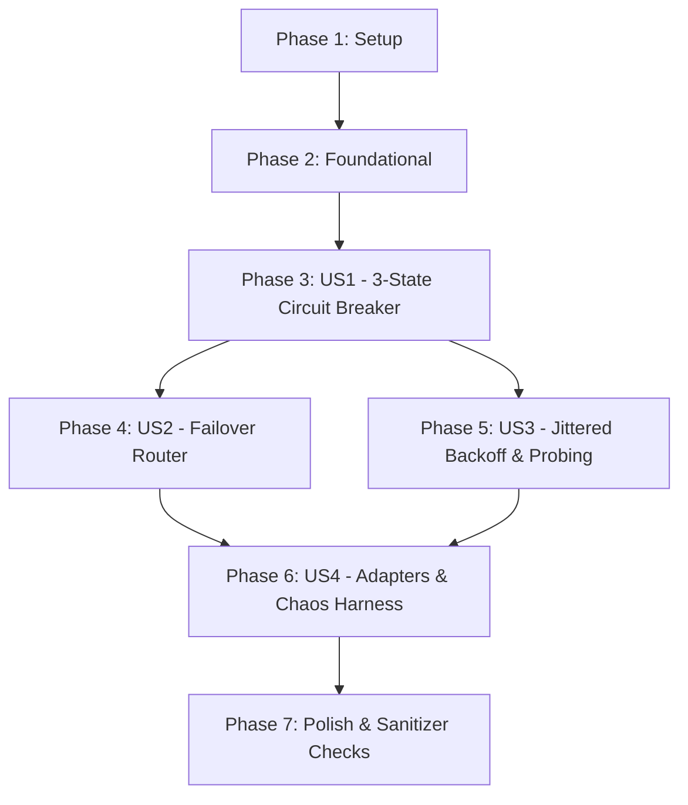

# Tasks: Circuit Breaker & Multi-Provider Failover

**Input**: Design documents from `/specs/004-circuit-breaker-failover/` (`spec.md`, `plan.md`, `research.md`, `data-model.md`, `contracts/circuit_breaker_contract.md`, `quickstart.md`)  
**Prerequisites**: `spec.md`, `plan.md`, `research.md`, `data-model.md`, `contracts/circuit_breaker_contract.md`  

---

## Format: `[ID] [P?] [Story] Description`

- **[P]**: Can run in parallel (different files, no incomplete dependencies)
- **[Story]**: Which user story this task belongs to (`[US1]`, `[US2]`, `[US3]`, `[US4]`)
- Include exact file paths in descriptions

---

## Phase 1: Setup (Shared Infrastructure)

**Purpose**: Project initialization, directory structure, data models, and build system configuration.

- [ ] T001 [P] Create directory structure for routing engine and upstream backend adapters in `include/tessera/routing/` and `src/routing/`
- [ ] T002 [P] Implement core domain entities (`CircuitState`, `CircuitBreakerConfig`, `CircuitBreakerStats`, `UpstreamRequest`, `UpstreamResponse`, `UpstreamProviderConfig`, `FailoverRouterStats`) in `include/tessera/routing/circuit_types.hpp`
- [ ] T003 Update `CMakeLists.txt` to register routing and upstream client sources and add unit/integration test targets

---

## Phase 2: Foundational (Blocking Prerequisites)

**Purpose**: Core interfaces and test doubles that MUST be complete before user story implementation begins.

**⚠️ CRITICAL**: No user story implementation can proceed until this phase is complete.

- [ ] T004 [P] Define `ICircuitBreaker` abstract interface in `include/tessera/routing/circuit_breaker.hpp`
- [ ] T005 [P] Define `IUpstreamClient` abstract interface in `include/tessera/backend/upstream_client.hpp`
- [ ] T006 Implement deterministic in-memory `MockUpstreamClient` with scriptable response queues, latency injection, and fault simulation (429, 500, timeouts) in `include/tessera/backend/mock_upstream_client.hpp` and `src/backend/mock_upstream_client.cpp`

**Checkpoint**: Core interfaces and test harness ready. User story implementation can now begin.

---

## Phase 3: User Story 1 - Deterministic 3-State Circuit Breaker (Priority: P1) 🎯 MVP

**Goal**: Implement a deterministic 3-state circuit breaker (`CLOSED`, `OPEN`, `HALF-OPEN`) with instantaneous trip on HTTP 429 quota exhaustion and trip on 3 consecutive 5xx errors or timeouts.

**Independent Test**: `./build/unit_tests --gtest_filter="CircuitBreakerTest.*"`

### Tests for User Story 1 ⚠️
- [ ] T007 [P] [US1] Create unit tests validating 3-state transitions, instant trip on HTTP 429, consecutive 5xx thresholds, and state resets in `tests/unit/test_circuit_breaker.cpp`

### Implementation for User Story 1
- [ ] T008 [US1] Implement `CircuitBreaker` class definition and atomic state tracking (`std::atomic<CircuitState>`, fast-path `CanAttempt()`) in `include/tessera/routing/circuit_breaker.hpp` and `src/routing/circuit_breaker.cpp`
- [ ] T009 [US1] Implement `RecordFailure()` with instant trip to `OPEN` on HTTP 429 and consecutive 5xx/timeout failure thresholding in `src/routing/circuit_breaker.cpp`
- [ ] T010 [US1] Implement `RecordSuccess()`, `Reset()`, and atomic telemetry retrieval in `src/routing/circuit_breaker.cpp`

**Checkpoint**: User Story 1 is functional and verifiable independently via unit tests.

---

## Phase 4: User Story 2 - Automated Multi-Provider Routing & Zero-Loss Failover (Priority: P1)

**Goal**: Coordinate Groq primary (`llama-3.3-70b-versatile`) and OpenRouter fallback (`google/gemma-2-9b-it`) with transparent retry upon 429/5xx, dynamic model translation, and zero dropped calls.

**Independent Test**: `./build/integration_tests --gtest_filter="FailoverIntegrationTest.*"`

### Tests for User Story 2 ⚠️
- [ ] T011 [P] [US2] Create integration tests validating transparent failover from Groq to OpenRouter on 429/5xx, direct fallback routing when primary is `OPEN`, and dual-provider failure handling in `tests/integration/test_failover_integration.cpp`

### Implementation for User Story 2
- [ ] T012 [US2] Implement `FailoverRouter` class inheriting `ICompletionBackend` coordinating primary/fallback clients and circuit breakers in `include/tessera/routing/failover_router.hpp` and `src/routing/failover_router.cpp`
- [ ] T013 [US2] Implement transparent in-flight retry, model parameter remapping (`llama-3.3-70b-versatile` $\rightarrow$ `google/gemma-2-9b-it`), and request metadata preservation in `src/routing/failover_router.cpp`
- [ ] T014 [US2] Implement dual-provider exhaustion returning `StatusCode::UNAVAILABLE` when both primary and fallback fail in `src/routing/failover_router.cpp`

**Checkpoint**: User Stories 1 and 2 deliver end-to-end resilient failover with 0 dropped client calls.

---

## Phase 5: User Story 3 - Jittered Exponential Backoff Cooldown & Recovery Probing (Priority: P2)

**Goal**: Implement truncated exponential backoff with full randomized jitter and single-probe gated `HALF-OPEN` recovery to prevent thundering herds.

**Independent Test**: `./build/unit_tests --gtest_filter="CircuitBreakerBackoffTest.*"` and `./build/integration_tests --gtest_filter="FailoverRecoveryTest.*"`

### Tests for User Story 3 ⚠️
- [ ] T015 [P] [US3] Create unit tests verifying exponential backoff calculation, truncation at `max_cooldown_ms`, and full randomized jitter bounds in `tests/unit/test_circuit_breaker.cpp`
- [ ] T016 [P] [US3] Create integration tests verifying single trial probe gating in `HALF-OPEN` and concurrent caller redirection to fallback in `tests/integration/test_failover_integration.cpp`

### Implementation for User Story 3
- [ ] T017 [US3] Implement full jitter exponential backoff calculation: $\text{cooldown} = \text{random}(0, \min(M, B \cdot 2^{\text{failures}}))$ using `thread_local std::mt19937_64` in `src/routing/circuit_breaker.cpp`
- [ ] T018 [US3] Implement atomic CAS probe gating (`probe_in_flight_`) permitting exactly 1 trial probe in `HALF-OPEN` while diverting concurrent requests in `src/routing/circuit_breaker.cpp`
- [ ] T019 [US3] Implement recovery transition from `HALF-OPEN` to `CLOSED` on probe HTTP 200 and re-trip with doubled backoff on probe failure in `src/routing/circuit_breaker.cpp`

**Checkpoint**: User Story 3 eliminates thundering herds and safely manages phased provider recovery.

---

## Phase 6: User Story 4 - Upstream Client Adapters & Chaos Failure Injection (Priority: P2)

**Goal**: Provide production-ready HTTP/2 upstream client adapters and an offline chaos testing harness simulating 429, 500, and timeout storms under high concurrency.

**Independent Test**: `./build/integration_tests --gtest_filter="ChaosMockTest.*"`

### Tests for User Story 4 ⚠️
- [ ] T020 [P] [US4] Create chaos fault injection concurrency test with 100 threads simulating intermittent 429 and 500 errors in `tests/integration/test_chaos_mock.cpp`

### Implementation for User Story 4
- [ ] T021 [P] [US4] Implement `HttpUpstreamClient` with OpenAI-compatible JSON serialization, auth headers, and response parsing in `include/tessera/backend/upstream_client.hpp` and `src/backend/upstream_client.cpp`
- [ ] T022 [US4] Wire `FailoverRouter` into the gateway pipeline in `src/main.cpp`
- [ ] T023 [US4] Update `tools/gateway_client.cpp` CLI tool to support upstream failover demonstrations, simulated provider faults, and circuit state reporting

**Checkpoint**: All 4 user stories are fully implemented, integrated, and verified offline.

---

## Phase 7: Polish & Cross-Cutting Concerns

**Purpose**: Comprehensive verification, documentation updates, and compliance checks across all user stories.

- [ ] T024 [P] Run full CTest suite (`unit_tests`, `integration_tests`, `ratelimit_concurrency_test`, `concurrency_test`) with zero leaks under AddressSanitizer and UndefinedBehaviorSanitizer
- [ ] T025 [P] Update `README.md` and `ROADMAP.md` documenting Milestone 4 completion, resilient routing architecture, and circuit breaker metrics
- [ ] T026 Execute quickstart validation scenarios per `specs/004-circuit-breaker-failover/quickstart.md`

---

## Dependencies & Execution Order

### Phase Dependencies

- **Setup (Phase 1)**: No dependencies — can start immediately.
- **Foundational (Phase 2)**: Depends on Phase 1 completion — BLOCKS all user stories.
- **User Story 1 (Phase 3)**: Depends on Phase 2 — MVP foundation.
- **User Story 2 (Phase 4)**: Depends on Phase 2 and Phase 3 (relies on `CircuitBreaker`).
- **User Story 3 (Phase 5)**: Enhances `CircuitBreaker` (Phase 3) with jittered backoff & probe gating.
- **User Story 4 (Phase 6)**: Builds on Phase 4 `FailoverRouter` and provides upstream client wiring and chaos stress testing.
- **Polish (Phase 7)**: Depends on all user stories being complete.



---

## Parallel Execution Examples

### Parallel Example: Setup & Foundational
```bash
# Can be executed in parallel (different files, no interdependencies):
Task T001: "Create directory structure in include/tessera/routing/ and src/routing/"
Task T002: "Implement core domain entities in include/tessera/routing/circuit_types.hpp"
Task T004: "Define ICircuitBreaker interface in include/tessera/routing/circuit_breaker.hpp"
Task T005: "Define IUpstreamClient interface in include/tessera/backend/upstream_client.hpp"
```

### Parallel Example: User Story 1
```bash
# Write unit tests first:
Task T007: "Create unit tests in tests/unit/test_circuit_breaker.cpp"
# Implement circuit breaker methods:
Task T008: "Implement CircuitBreaker atomic state tracking in src/routing/circuit_breaker.cpp"
```

### Parallel Example: User Story 2 & 3 Tests
```bash
# Test files are independent and can be created in parallel:
Task T011: "Create integration tests in tests/integration/test_failover_integration.cpp"
Task T015: "Create backoff unit tests in tests/unit/test_circuit_breaker.cpp"
```

---

## Implementation Strategy

### MVP First (User Story 1 & 2)
1. Complete Phase 1: Setup (`T001`–`T003`)
2. Complete Phase 2: Foundational (`T004`–`T006`)
3. Complete Phase 3: User Story 1 (`T007`–`T010`) $\rightarrow$ Validate with `./build/unit_tests`
4. Complete Phase 4: User Story 2 (`T011`–`T014`) $\rightarrow$ Validate with `./build/integration_tests`
5. **STOP and VALIDATE**: Core failover and instant 429 trip are fully functional with 0 dropped calls.

### Incremental Delivery (User Stories 3 & 4)
6. Add Phase 5: Jittered exponential backoff and single-probe `HALF-OPEN` recovery (`T015`–`T019`).
7. Add Phase 6: HTTP client adapters, pipeline wiring, and chaos test harness (`T020`–`T023`).
8. Execute Phase 7: Polish, ASan/UBSan checks, documentation, and quickstart scenarios (`T024`–`T026`).

