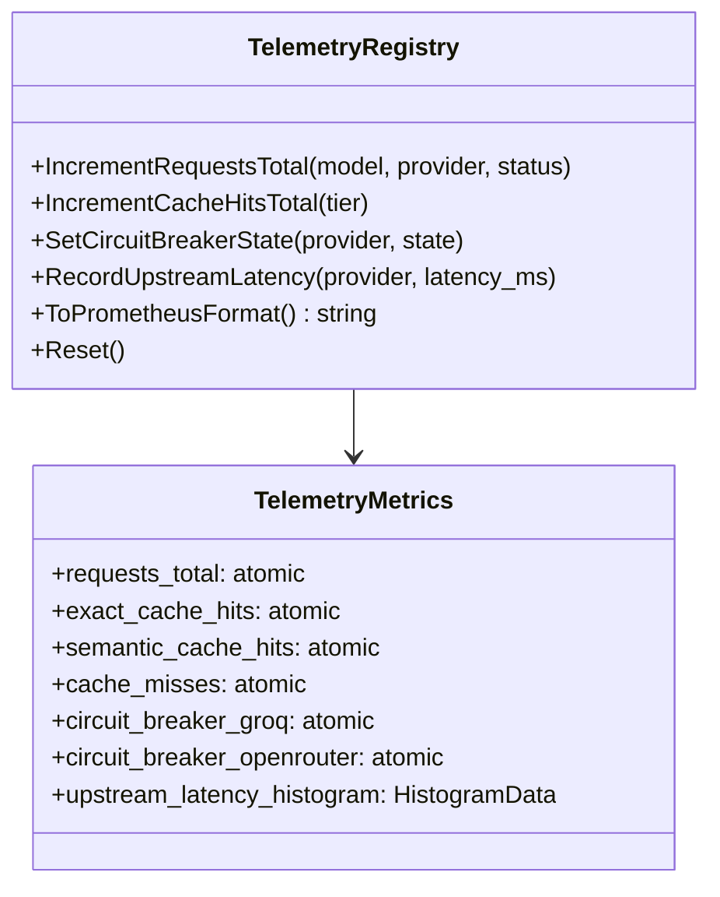
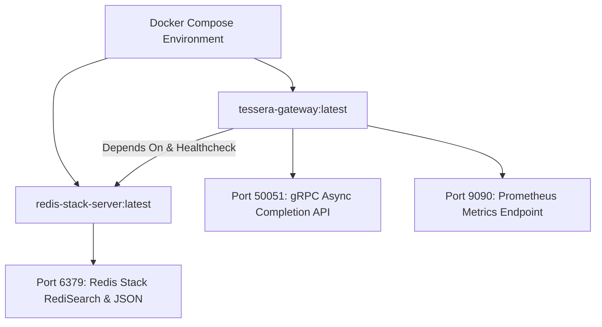

# Data Model: Evaluation Harness, OpenTelemetry Metrics & Containerized Benchmarks

**Feature Branch**: `005-benchmarks-and-telemetry`  
**Date**: 2026-11-06  
**Status**: Completed  

---

## 1. Observability & Telemetry Entities

### 1.1 `MetricType` (Enum)
Classifies the collection and aggregation semantics of an instrumented telemetry metric.

```cpp
namespace tessera {

enum class MetricType : uint8_t {
  COUNTER = 0,    // Monotonically increasing unsigned 64-bit counter
  GAUGE = 1,      // Arbitrary value that can increase or decrease (e.g., circuit state)
  HISTOGRAM = 2   // Value distribution partitioned into pre-configured buckets
};

}  // namespace tessera
```

---

### 1.2 `MetricLabel` & `LabelSet` (Structs)
Dimensional tags attached to metric observations following OpenTelemetry semantic conventions.

```cpp
struct MetricLabel {
  std::string key;
  std::string value;

  bool operator==(const MetricLabel& other) const noexcept {
    return key == other.key && value == other.value;
  }
};

using LabelSet = std::vector<MetricLabel>;
```

---

### 1.3 `HistogramBucket` & `HistogramData` (Structs)
Thread-safe bucketed distribution tracking latencies without lock contention.

| Field | Type | Description |
|---|---|---|
| `upper_bound_ms` | `double` | Upper limit for this latency bucket (e.g. 1.0, 5.0, 20.0, 100.0, 500.0) |
| `count` | `std::atomic<uint64_t>` | Number of observations falling into this bucket |

```cpp
struct HistogramData {
  std::vector<double> bucket_bounds = {1.0, 2.0, 5.0, 10.0, 25.0, 50.0, 100.0, 250.0, 500.0, 1000.0, 2500.0, 5000.0};
  std::vector<std::atomic<uint64_t>> bucket_counts;
  std::atomic<uint64_t> total_count{0};
  std::atomic<double> sum{0.0};
};
```

---

### 1.4 `TelemetryRegistry` (Class)
Thread-safe registry coordinating all gateway metrics.



---

## 2. Synthetic Evaluation Dataset & Benchmark Entities

### 2.1 `EvaluationQuery` (Struct)
Defines a structured test query in the 1,000-sample benchmark dataset.

| Field | Type | Description | Validation / Constraints |
|---|---|---|---|
| `id` | `uint32_t` | Sequential identifier (1 to 1000) | Strictly $1 \le \text{id} \le 1000$ |
| `prompt` | `std::string` | The user prompt string to send to the gateway | Non-empty, valid UTF-8 |
| `is_paraphrase` | `bool` | True if this query is a semantic paraphrase of a prior query | 300 queries must have `true` (30%) |
| `base_query_id` | `std::optional<uint32_t>` | ID of the original base prompt if `is_paraphrase` is true | Points to valid base query ID |
| `category` | `std::string` | Prompt domain (e.g., `"coding"`, `"reasoning"`, `"system"`) | Non-empty |
| `expected_tier` | `std::string` | Expected cache tier resolution (`"exact"`, `"semantic"`, `"upstream"`) | Enum or validated string |

---

### 2.2 `EvaluationReport` (Struct)
Statistical outcome generated after executing the 1,000-query benchmark run.

| Field | Type | Description | Target SLA / Gate |
|---|---|---|---|
| `total_queries` | `uint32_t` | Total queries executed | `1,000` |
| `tier1_exact_hits` | `uint32_t` | Queries resolved from SHA-256 Redis cache | $> 0$ |
| `tier2_semantic_hits` | `uint32_t` | Queries resolved from ONNX vector search | $\ge 250$ (of 300 paraphrases) |
| `upstream_executions` | `uint32_t` | Queries dispatched to upstream LLM | $\le 750$ |
| `cache_hit_ratio_pct` | `double` | Total cache hits divided by total queries | $> 25.0\%$ |
| `cold_p95_latency_ms` | `double` | 95th percentile latency of un-cached upstream calls | Baseline (e.g. 150-300ms) |
| `warm_p95_latency_ms` | `double` | 95th percentile latency of cached calls | $< 20\text{ms}$ |
| `p95_latency_reduction_pct` | `double` | Relative latency reduction | $> 80.0\%$ |
| `token_savings_pct` | `double` | Estimated token expenditure reduction | $> 25.0\%$ |
| `throughput_rps` | `double` | Aggregate requests processed per second | $> 1,000\text{ RPS}$ |
| `max_rss_mb` | `double` | Peak resident memory during evaluation | $< 500\text{MB}$ |

---

## 3. Container Orchestration Profile

### 3.1 Service Dependency Graph



### 3.2 Container Configuration Parameters

| Parameter | Default Value | Description |
|---|---|---|
| `REDIS_HOST` | `redis-stack` | Container hostname of the Redis Stack instance |
| `REDIS_PORT` | `6379` | Network port for Redis protocol connections |
| `GATEWAY_PORT` | `50051` | gRPC server listening port |
| `METRICS_PORT` | `9090` | HTTP metrics exposition port |
| `WORKER_THREADS` | `8` | Number of async completion queue worker threads |
| `CACHE_TTL` | `86400` | Cache time-to-live in seconds (24 hours) |
| `SIMILARITY_THRESHOLD` | `0.95` | Cosine similarity cutoff for Tier 2 semantic matches |

