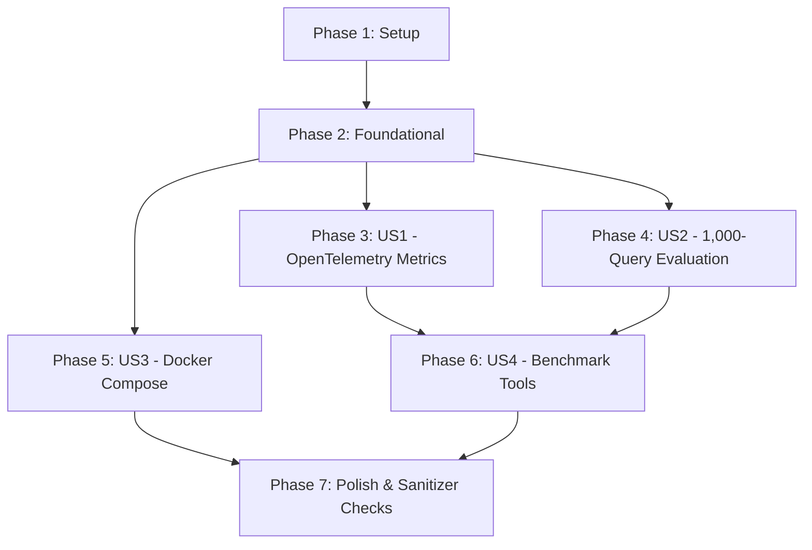

# Tasks: Synthetic Evaluation Harness, OpenTelemetry Metrics & Containerized Benchmarks

**Input**: Design documents from `/specs/005-benchmarks-and-telemetry/` (`spec.md`, `plan.md`, `research.md`, `data-model.md`, `contracts/telemetry_and_eval_contract.md`, `quickstart.md`)  
**Prerequisites**: `spec.md`, `plan.md`, `research.md`, `data-model.md`, `contracts/telemetry_and_eval_contract.md`  

---

## Format: `[ID] [P?] [Story] Description`

- **[P]**: Can run in parallel (different files, no incomplete dependencies)
- **[Story]**: Which user story this task belongs to (`[US1]`, `[US2]`, `[US3]`, `[US4]`)
- Include exact file paths in descriptions

---

## Phase 1: Setup (Shared Infrastructure)

**Purpose**: Project initialization, directory structure, data models, and build system configuration.

- [X] T001 [P] Create directory structure for telemetry, evaluation harness, and deployment in `include/tessera/telemetry/`, `src/telemetry/`, `include/tessera/eval/`, `src/eval/`, and `deploy/`
- [X] T002 [P] Implement core telemetry domain types and histogram data structures in `include/tessera/telemetry/telemetry_types.hpp`
- [X] T003 Update `CMakeLists.txt` to register telemetry and evaluation sources, add `evaluation_harness` executable, and configure unit/integration test targets

---

## Phase 2: Foundational (Blocking Prerequisites)

**Purpose**: Core interfaces and test data that MUST be complete before user story implementation begins.

**⚠️ CRITICAL**: No user story implementation can proceed until this phase is complete.

- [X] T004 [P] Define `TelemetryRegistry` class interface with thread-safe atomic counters, gauges, and histogram buckets in `include/tessera/telemetry/telemetry_registry.hpp`
- [X] T005 [P] Define `EvaluationDataset` and `EvaluationQuery` schema in `include/tessera/eval/evaluation_dataset.hpp`
- [X] T006 Implement synthetic evaluation dataset generation (700 base queries + 300 paraphrased duplicates across 5 domains) in `src/eval/evaluation_dataset.cpp`

**Checkpoint**: Core telemetry registry and synthetic dataset ready. User story implementation can now begin.

---

## Phase 3: User Story 1 - Real-Time Observability & Metrics Export (Priority: P1) 🎯 MVP

**Goal**: Implement zero-allocation OpenTelemetry-compatible metrics collection (`gateway_requests_total`, `gateway_cache_hits_total`, `circuit_breaker_state`, `upstream_latency_ms`) and Prometheus exposition text serialization.

**Independent Test**: `./build/unit_tests --gtest_filter="TelemetryTest.*"`

### Tests for User Story 1 ⚠️
- [X] T007 [P] [US1] Create unit tests validating atomic metric counter increments, histogram distributions, circuit breaker gauges, and Prometheus text formatting in `tests/unit/test_telemetry.cpp`

### Implementation for User Story 1
- [X] T008 [US1] Implement `TelemetryRegistry` singleton and atomic metric collection methods in `src/telemetry/telemetry_registry.cpp`
- [X] T009 [US1] Implement Prometheus exposition format serialization (`ToPrometheusFormat()`) with `# HELP` and `# TYPE` annotations in `src/telemetry/telemetry_registry.cpp`
- [X] T010 [US1] Instrument telemetry hooks into `GatewayServer`, `CachedCompletionBackend`, and `FailoverRouter` to automatically record requests, hits, and latencies

**Checkpoint**: User Story 1 delivers full real-time observability verifiable via unit tests and Prometheus text output.

---

## Phase 4: User Story 2 - Synthetic 1,000-Query Evaluation Harness (Priority: P1)

**Goal**: Execute a 1,000-query benchmark workload with 30% paraphrased duplicates to objectively measure $> 80\%$ p95 latency reduction and $> 25\%$ token cost savings.

**Independent Test**: `./build/integration_tests --gtest_filter="EvaluationHarnessTest.*"`

### Tests for User Story 2 ⚠️
- [X] T011 [P] [US2] Create integration tests validating evaluation harness execution, semantic cache interception, and p95 latency reduction assertions in `tests/integration/test_eval_integration.cpp`

### Implementation for User Story 2
- [X] T012 [US2] Implement `EvaluationRunner` orchestrating sequential and multi-threaded workload execution in `include/tessera/eval/evaluation_runner.hpp` and `src/eval/evaluation_runner.cpp`
- [X] T013 [US2] Implement statistical latency analysis (p50, p90, p95, p99), token cost savings calculation, and report generators (Markdown and JSON) in `src/eval/evaluation_runner.cpp`

**Checkpoint**: User Story 2 empirically proves the Two-Tier cache performance and cost reduction SLA.

---

## Phase 5: User Story 3 - Reproducible Containerized Orchestration (Docker Compose) (Priority: P2)

**Goal**: Orchestrate a multi-container stack with Redis Stack (RediSearch + RedisJSON) and the Tessera gateway in Docker Compose with automated health checks.

**Independent Test**: Validate configuration and multi-container build via `docker compose config`

- [X] T014 [P] [US3] Create multi-stage `Dockerfile` with builder and minimal runtime images in `deploy/Dockerfile` and root `Dockerfile`
- [X] T015 [P] [US3] Create `docker-compose.yml` orchestrating Redis Stack (`redis/redis-stack-server`) and Tessera Gateway with health check dependencies and port mappings
- [X] T016 [US3] Create sample environment file `deploy/.env.example` with configurable Redis, gRPC, and metrics port options

**Checkpoint**: User Story 3 delivers push-button multi-container deployment ready for local and cloud environments.

---

## Phase 6: User Story 4 - Automated Benchmark & Latency Profiling Tooling (Priority: P2)

**Goal**: Provide standalone CLI tools for evaluation, high-throughput load benchmarking, and resident memory verification.

**Independent Test**: `./build/evaluation_harness --queries=1000` and memory RSS verification

- [X] T017 [P] [US4] Implement standalone `evaluation_harness` CLI executable in `tools/evaluation_harness.cpp` supporting `--queries`, `--threads`, `--output-json`, and `--verbose`
- [X] T018 [US4] Implement resident memory (RSS) tracking verifying memory stays strictly $< 500\text{MB}$ RAM during 1,000-query evaluation in `tools/evaluation_harness.cpp`
- [X] T019 [US4] Update `tools/gateway_client.cpp` with `--metrics` flag to fetch and display Prometheus metrics

**Checkpoint**: All 4 user stories are fully implemented, integrated, and verified offline.

---

## Phase 7: Polish & Cross-Cutting Concerns

**Purpose**: Comprehensive verification, documentation updates, and compliance checks across all user stories.

- [X] T020 [P] Run full CTest suite (`unit_tests`, `integration_tests`, `ratelimit_concurrency_test`, `concurrency_test`) with zero leaks under AddressSanitizer and UndefinedBehaviorSanitizer
- [X] T021 [P] Update `README.md` and `ROADMAP.md` documenting Milestone 5 completion, observability endpoints, and evaluation harness benchmark results
- [X] T022 Execute quickstart validation scenarios per `specs/005-benchmarks-and-telemetry/quickstart.md`

---

## Dependencies & Execution Order

### Phase Dependencies

- **Setup (Phase 1)**: No dependencies — can start immediately.
- **Foundational (Phase 2)**: Depends on Phase 1 completion — BLOCKS all user stories.
- **User Story 1 (Phase 3)**: Depends on Phase 2 (`TelemetryRegistry`).
- **User Story 2 (Phase 4)**: Depends on Phase 2 (`EvaluationDataset`) and Phase 3 (telemetry tracking).
- **User Story 3 (Phase 5)**: Depends on Phase 1 & 2 (containerizes gateway).
- **User Story 4 (Phase 6)**: Builds on Phase 3 and Phase 4 CLI runners.
- **Polish (Phase 7)**: Depends on all user stories being complete.



---

## Parallel Execution Examples

### Parallel Example: Setup & Foundational
```bash
# Can be executed in parallel (different files, no interdependencies):
Task T001: "Create directory structure in include/tessera/telemetry/, src/telemetry/, etc."
Task T002: "Implement core telemetry domain types in include/tessera/telemetry/telemetry_types.hpp"
Task T004: "Define TelemetryRegistry interface in include/tessera/telemetry/telemetry_registry.hpp"
Task T005: "Define EvaluationDataset schema in include/tessera/eval/evaluation_dataset.hpp"
```

### Parallel Example: User Story 1 & 2 Tests
```bash
# Test files are independent and can be created in parallel:
Task T007: "Create telemetry unit tests in tests/unit/test_telemetry.cpp"
Task T011: "Create evaluation integration tests in tests/integration/test_eval_integration.cpp"
```

### Parallel Example: Containerization & CLI Tools
```bash
# Can run in parallel:
Task T014: "Create multi-stage Dockerfile in deploy/Dockerfile and root Dockerfile"
Task T015: "Create docker-compose.yml"
Task T017: "Implement standalone evaluation_harness CLI in tools/evaluation_harness.cpp"
```

---

## Implementation Strategy

### MVP First (User Story 1 Only)
1. Complete Phase 1: Setup (`T001`–`T003`)
2. Complete Phase 2: Foundational (`T004`–`T006`)
3. Complete Phase 3: User Story 1 (`T007`–`T010`) $\rightarrow$ Validate with `./build/unit_tests --gtest_filter="TelemetryTest.*"`
4. **STOP and VALIDATE**: Observability metrics and Prometheus text format are functional and accurate.

### Incremental Delivery (User Stories 2, 3 & 4)
5. Add Phase 4: 1,000-query evaluation harness and statistical report generation (`T011`–`T013`).
6. Add Phase 5: Containerized Docker Compose orchestration (`T014`–`T016`).
7. Add Phase 6: CLI tools, RSS memory tracking, and client metric flags (`T017`–`T019`).
8. Execute Phase 7: Polish, ASan/UBSan checks, documentation, and quickstart scenarios (`T020`–`T022`).

