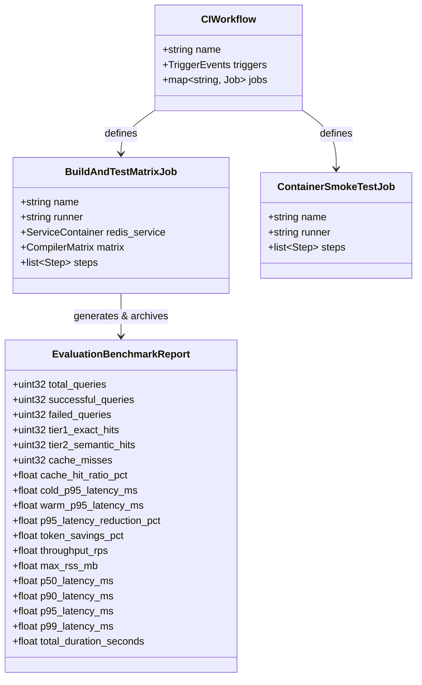

# Data Model: CI Matrix & Automated Container Release Pipeline

**Feature**: `006-ci-matrix-container-release`  
**Date**: 2026-11-14  
**Status**: Completed  

---

## 1. CI Workflow Entities

---

## 2. Entity Definitions

### 2.1 CompilerMatrixSlice
Represents an individual compiler and sanitizer configuration within the `build-and-test` job.

| Field | Type | Example Values | Description |
|---|---|---|---|
| `compiler` | `string` | `"gcc"`, `"clang"` | Display name of the toolchain |
| `cc` | `string` | `"gcc"`, `"clang"` | C compiler executable |
| `cxx` | `string` | `"g++"`, `"clang++"` | C++ compiler executable |
| `build_type` | `string` | `"Release"`, `"Debug"` | CMake build configuration |
| `sanitizer` | `string` | `"none"`, `"address,undefined"` | Memory and undefined behavior sanitizer flags |
| `enable_sanitizers` | `boolean` | `false`, `true` | Value passed to `-DENABLE_SANITIZERS` |

### 2.2 EvaluationBenchmarkReport
The machine-readable JSON structure generated by `EvaluationRunner::Run()` and persisted as `eval_report.json`.

| Field | Type | Validation Rule | Description |
|---|---|---|---|
| `total_queries` | `uint32` | `== 1000` | Total number of queries submitted in the benchmark |
| `successful_queries` | `uint32` | `== 1000` | Number of requests completed with Status::OK |
| `failed_queries` | `uint32` | `== 0` | Must strictly equal 0 for passing CI gate |
| `tier1_exact_hits` | `uint32` | `>= 0` | Requests resolved via SHA-256 exact-match cache |
| `tier2_semantic_hits` | `uint32` | `>= 250` | Requests resolved via vector similarity search ($S \ge 0.95$) |
| `cache_misses` | `uint32` | `<= 750` | Requests forwarded to upstream execution backend |
| `cache_hit_ratio_pct` | `float` | `> 25.0` | Overall percentage of cached queries |
| `cold_p95_latency_ms` | `float` | `> 20.0` | Baseline 95th percentile latency of un-cached upstream calls |
| `warm_p95_latency_ms` | `float` | `< 20.0` | 95th percentile latency of cached responses |
| `p95_latency_reduction_pct` | `float` | `>= 80.0` | Latency reduction gate: $\frac{\text{cold} - \text{warm}}{\text{cold}} \times 100$ |
| `token_savings_pct` | `float` | `>= 25.0` | Token billing reduction due to cache interception |
| `throughput_rps` | `float` | `>= 1000.0` | Aggregate requests completed per second |
| `max_rss_mb` | `float` | `< 500.0` | Peak resident set size (RSS) memory consumption |
| `p50_latency_ms` | `float` | `> 0.0` | 50th percentile (median) request latency |
| `p90_latency_ms` | `float` | `> 0.0` | 90th percentile request latency |
| `p95_latency_ms` | `float` | `> 0.0` | 95th percentile request latency |
| `p99_latency_ms` | `float` | `> 0.0` | 99th percentile request latency |
| `total_duration_seconds` | `float` | `> 0.0` | Wall-clock elapsed duration for entire evaluation |

### 2.3 ContainerReleaseProfile
Defines the parameters and verification gates for the automated Docker build job.

| Field | Type | Value | Description |
|---|---|---|---|
| `image_tag` | `string` | `tessera-gateway:ci` | Local build tag for smoke test |
| `dockerfile_path` | `string` | `deploy/Dockerfile` | Multi-stage production container specification |
| `user_uid` | `uint32` | `10001` | Non-root security user ID (`tessera`) |
| `exposed_ports` | `list<uint16>` | `[50051, 9090]` | Service port (gRPC) and metrics port (Prometheus) |
| `health_probe_command` | `string` | `/usr/local/bin/gateway_client --health` | Automated probe verifying `SERVING` health status |
| `max_startup_seconds` | `uint32` | `30` | Maximum allowable time to reach healthy state |

