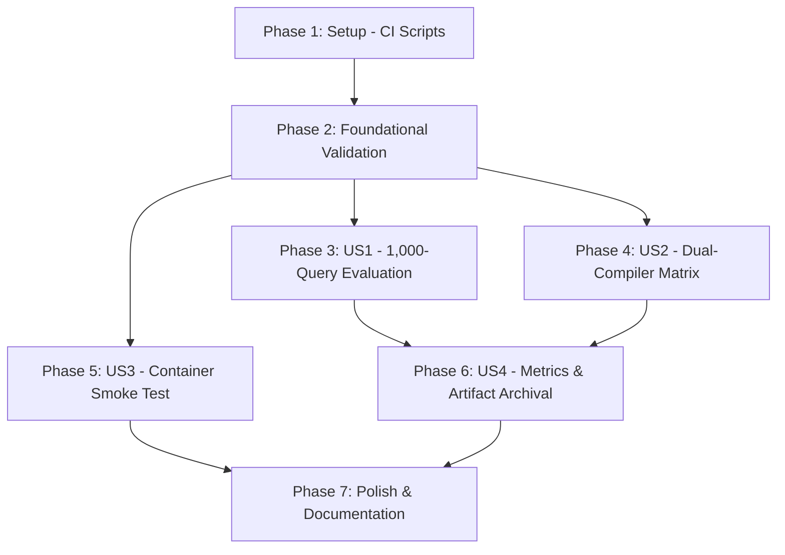

# Tasks: CI Matrix & Automated Container Release Pipeline

**Input**: Design documents from `/specs/006-ci-matrix-container-release/` (`spec.md`, `plan.md`, `research.md`, `data-model.md`, `contracts/ci_workflow_contract.md`, `quickstart.md`)  
**Prerequisites**: `spec.md`, `plan.md`, `research.md`, `data-model.md`, `contracts/ci_workflow_contract.md`  

---

## Format: `[ID] [P?] [Story] Description`

- **[P]**: Can run in parallel (different files, no incomplete dependencies)
- **[Story]**: Which user story this task belongs to (`[US1]`, `[US2]`, `[US3]`, `[US4]`)
- Include exact file paths in descriptions

---

## Phase 1: Setup (Shared Infrastructure)

**Purpose**: Establish automated verification scripts and tooling used by the CI pipeline.

- [ ] T001 Create CI scripts directory in `scripts/`
- [ ] T002 Implement automated evaluation SLA gate validation script verifying failed_queries==0, p95_latency_reduction>=80%, token_savings>=25%, and max_rss_mb<500 in `scripts/verify_ci_gates.py`
- [ ] T003 [P] Implement Prometheus metrics text exposition format validation script in `scripts/verify_metrics_format.sh`

---

## Phase 2: Foundational (Blocking Prerequisites)

**Purpose**: Validate that verification scripts operate deterministically before updating the GitHub Actions workflow.

**⚠️ CRITICAL**: No workflow updates can proceed until these scripts are validated.

- [ ] T004 Validate `scripts/verify_ci_gates.py` against valid and failing mock benchmark JSON files
- [ ] T005 [P] Validate `scripts/verify_metrics_format.sh` against live output from `./build/gateway_client --metrics`

**Checkpoint**: Verification scripts validated. GitHub Actions workflow modifications can now proceed.

---

## Phase 3: User Story 1 - Automated High-Scale Synthetic Evaluation in CI (Priority: P1) 🎯 MVP

**Goal**: Automatically execute the 1,000-query evaluation harness on all PRs and pushes to main branches, gating on latency reduction and token savings.

**Independent Test**: Simulate CI step: `./build/evaluation_harness --queries=1000 --threads=4 --output-json=eval_report.json && python3 scripts/verify_ci_gates.py eval_report.json`

### Implementation for User Story 1
- [ ] T006 [US1] Add synthetic 1,000-query evaluation harness execution step with `--threads=4` and `--output-json=eval_report.json` to `.github/workflows/ci.yml`
- [ ] T007 [US1] Add automated SLA gate enforcement step running `python3 scripts/verify_ci_gates.py eval_report.json` to `.github/workflows/ci.yml`
- [ ] T008 [US1] Configure step failure behavior and error reporting for breached latency, token, or memory gates in `.github/workflows/ci.yml`

**Checkpoint**: User Story 1 complete. CI automatically gates pull requests on 1,000-query benchmark results.

---

## Phase 4: User Story 2 - Dual-Compiler Matrix & Zero-Tolerance Memory Sanitizers (Priority: P1)

**Goal**: Enforce dual-compiler matrix execution across GCC 13 (Release) and Clang 17 (Debug with AddressSanitizer and UndefinedBehaviorSanitizer).

**Independent Test**: Run workflow across both matrix legs; confirm both compile with `-Wall -Wextra -Wpedantic` and pass with 0 memory leaks.

### Implementation for User Story 2
- [ ] T009 [US2] Update matrix strategy in `.github/workflows/ci.yml` to define GCC 13 (Release mode) and Clang 17 (Debug mode with AddressSanitizer and UBSan)
- [ ] T010 [US2] Configure dynamic compiler setup, environment exports (`CC`, `CXX`), and CMake sanitizer flags (`-DENABLE_SANITIZERS=ON`) in `.github/workflows/ci.yml`
- [ ] T011 [US2] Ensure all test targets (`ctest`, `concurrency_test`, `ratelimit_concurrency_test`, `cache_benchmark`, `semantic_benchmark`, `evaluation_harness`) execute across both compiler matrix jobs in `.github/workflows/ci.yml`

**Checkpoint**: User Story 2 complete. Both GCC 13 and Clang 17 (ASan/UBSan) continuously enforce zero-leak code quality.

---

## Phase 5: User Story 3 - Automated Container Build & Live Health Probe Smoke Testing (Priority: P2)

**Goal**: Automate multi-stage Docker image builds and live health probe verification within a multi-container stack.

**Independent Test**: Run container smoke test: build `deploy/Dockerfile`, start `deploy/docker-compose.yml`, verify healthy status, run `/usr/local/bin/gateway_client --health`, and tear down.

### Implementation for User Story 3
- [ ] T012 [US3] Add dedicated `container-smoke-test` job running on `ubuntu-latest` in `.github/workflows/ci.yml`
- [ ] T013 [US3] Add multi-stage Docker image build step (`docker build -f deploy/Dockerfile -t tessera-gateway:ci .`) in `.github/workflows/ci.yml`
- [ ] T014 [US3] Add multi-container stack orchestration step (`docker compose -f deploy/docker-compose.yml up -d`) with automated health check wait in `.github/workflows/ci.yml`
- [ ] T015 [US3] Add in-container health probe execution (`docker exec tessera-gateway /usr/local/bin/gateway_client --health`) and test query execution in `.github/workflows/ci.yml`
- [ ] T016 [US3] Add clean container stack teardown step (`docker compose -f deploy/docker-compose.yml down -v`) in `.github/workflows/ci.yml`

**Checkpoint**: User Story 3 complete. Production container images and multi-container configurations are automatically verified in CI.

---

## Phase 6: User Story 4 - Metrics Exposition Verification & Build Artifact Archival (Priority: P2)

**Goal**: Validate Prometheus metrics exposition format and archive benchmark reports as downloadable workflow artifacts.

**Independent Test**: Verify metrics format via `bash scripts/verify_metrics_format.sh` and inspect uploaded workflow artifacts.

### Implementation for User Story 4
- [ ] T017 [US4] Add Prometheus metrics exposition validation step running `bash scripts/verify_metrics_format.sh` to `.github/workflows/ci.yml`
- [ ] T018 [US4] Add `actions/upload-artifact@v4` step archiving `eval_report.json` as `evaluation-report-${{ matrix.compiler }}` in `.github/workflows/ci.yml`

**Checkpoint**: User Story 4 complete. Telemetry contracts are verified and evaluation reports are archived on every CI run.

---

## Phase 7: Polish & Cross-Cutting Concerns

**Purpose**: Documentation updates, final verification, and constitution compliance checks.

- [ ] T019 [P] Update `ROADMAP.md` documenting Milestone 6 completion and automated CI/CD pipeline capabilities
- [ ] T020 [P] Update `README.md` with CI matrix status, container release documentation, and evaluation gating guarantees
- [ ] T021 Execute full local validation run simulating all CI steps per `specs/006-ci-matrix-container-release/quickstart.md`

---

## Dependencies & Execution Order

### Phase Dependencies

- **Setup (Phase 1)**: No dependencies — can start immediately.
- **Foundational (Phase 2)**: Depends on Phase 1 completion — BLOCKS workflow modifications.
- **User Story 1 (Phase 3)**: Depends on Phase 2 (`scripts/verify_ci_gates.py`).
- **User Story 2 (Phase 4)**: Depends on Phase 2; can be integrated into `.github/workflows/ci.yml` alongside US1.
- **User Story 3 (Phase 5)**: Depends on container files (`deploy/Dockerfile`, `deploy/docker-compose.yml`); independent job.
- **User Story 4 (Phase 6)**: Builds on US1 (`eval_report.json`) and Phase 1 (`scripts/verify_metrics_format.sh`).
- **Polish (Phase 7)**: Depends on all user stories being complete.



---

## Parallel Execution Examples

### Parallel Example: Setup Phase
```bash
# Can run in parallel:
Task T002: "Implement automated evaluation SLA gate validation script in scripts/verify_ci_gates.py"
Task T003: "Implement Prometheus metrics text exposition format validation script in scripts/verify_metrics_format.sh"
```

### Parallel Example: Polish Phase
```bash
# Can run in parallel:
Task T019: "Update ROADMAP.md documenting Milestone 6 completion"
Task T020: "Update README.md with CI matrix status and container release docs"
```

---

## Implementation Strategy

### MVP First (User Story 1 Only)
1. Complete Phase 1: Setup (`scripts/verify_ci_gates.py`, `scripts/verify_metrics_format.sh`)
2. Complete Phase 2: Foundational (local validation of verification scripts)
3. Complete Phase 3: User Story 1 (evaluation harness step in CI workflow)
4. Validate that CI gates correctly on 1,000-query benchmark results.

### Incremental Delivery
1. Add User Story 2 (Dual-compiler matrix for GCC 13 and Clang 17 with ASan/UBSan)
2. Add User Story 3 (Dedicated container build & compose smoke testing job)
3. Add User Story 4 (Prometheus metrics validation & artifact upload)
4. Complete Polish (Documentation and final quickstart validation)

