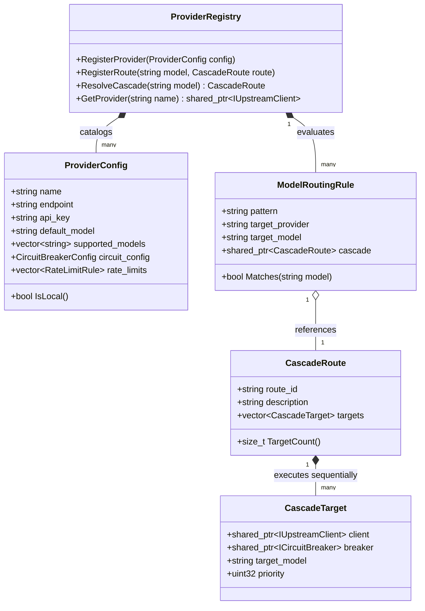
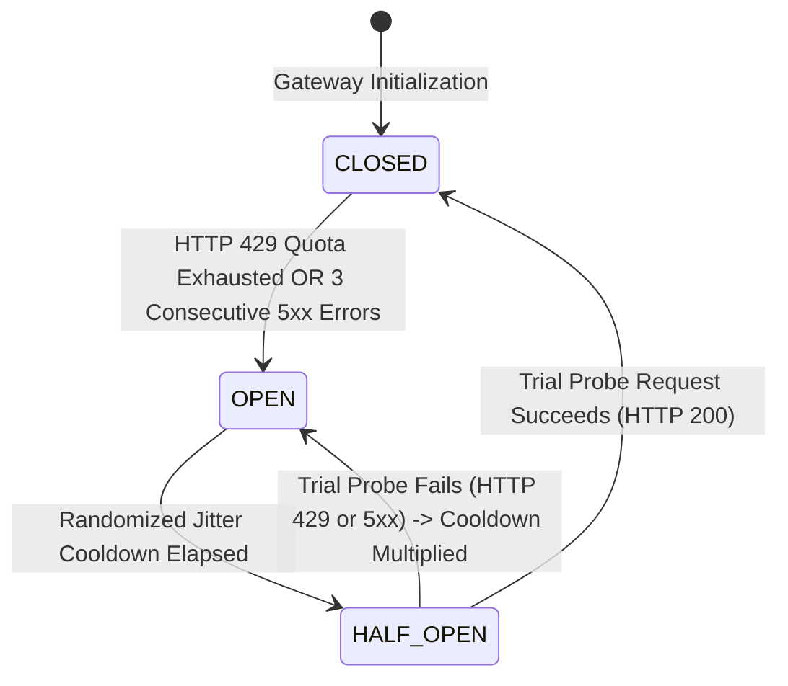
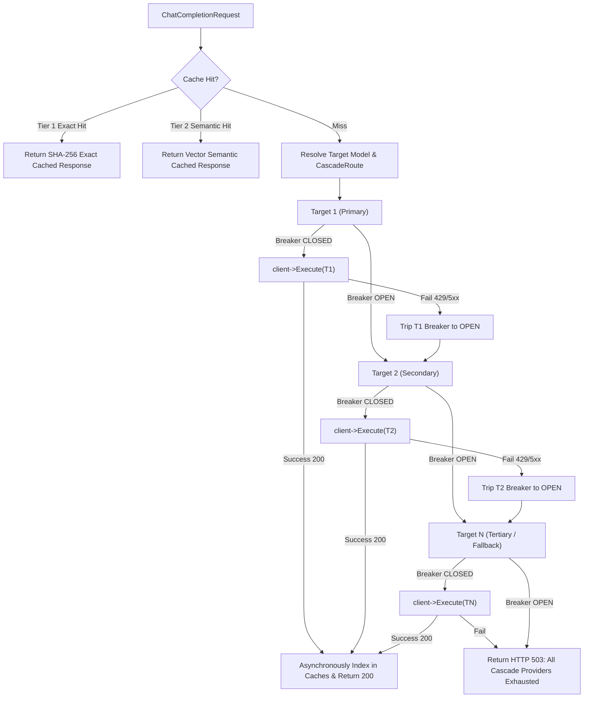

# Data Model: Provider-Agnostic Routing & Dynamic Model Cascade

**Feature**: `007-provider-agnostic-routing`  
**Date**: 2026-11-19  
**Status**: Completed  

---

## 1. Domain Entities & Relationships

---

## 2. Entity Specifications

### 2.1 ProviderConfig
Represents the static declaration of an upstream AI service.

| Field | Type | Required | Description | Validation Rules |
| :--- | :--- | :---: | :--- | :--- |
| `name` | `std::string` | Yes | Unique provider identifier (e.g. `groq`, `deepseek`, `ollama`) | Alphanumeric + hyphens, lowercase, non-empty |
| `endpoint` | `std::string` | Yes | Upstream HTTP/HTTPS base URL | Must start with `http://` or `https://` |
| `api_key` | `std::string` | No | Upstream API bearer secret | Optional (empty for local runtimes like Ollama/vLLM) |
| `default_model` | `std::string` | Yes | Canonical model identifier served by this provider | Non-empty string |
| `supported_models` | `std::vector<std::string>` | No | List of additional models available on this provider | Non-empty if specified |
| `circuit_config` | `CircuitBreakerConfig` | No | Failure threshold, base cooldown, max cooldown | Positive integers |
| `rate_limits` | `std::vector<RateLimitRule>` | No | Per-window request and token bucket constraints | Valid capacities and refill rates |

### 2.2 CascadeTarget
Represents an individual stage within an $N$-tier fallback sequence.

| Field | Type | Description |
| :--- | :--- | :--- |
| `client` | `std::shared_ptr<IUpstreamClient>` | Executable HTTP client pointing to the provider endpoint |
| `breaker` | `std::shared_ptr<ICircuitBreaker>` | Dedicated 3-state circuit breaker governing this provider stage |
| `target_model` | `std::string` | Target model name to forward to this provider stage (overriding original model if needed) |
| `priority` | `uint32_t` | Sequence rank (0 = primary, 1 = secondary, etc.) |

### 2.3 CascadeRoute
An ordered sequence of fallback targets evaluated progressively until one succeeds.

| Field | Type | Description |
| :--- | :--- | :--- |
| `route_id` | `std::string` | Model pattern or route name (e.g., `default`, `deepseek-chat`, `coding-cascade`) |
| `targets` | `std::vector<CascadeTarget>` | Non-empty ordered sequence of candidate targets |

### 2.4 ModelRoutingRule
Defines how incoming model requests map to cascade routes.

| Field | Type | Description |
| :--- | :--- | :--- |
| `pattern` | `std::string` | Exact model name (`deepseek-chat`) or wildcard prefix (`ollama/*`, `groq/*`) |
| `cascade` | `std::shared_ptr<CascadeRoute>` | Target cascade route executed when pattern matches |

---

## 3. State Machine & Lifecycle Transitions

### 3.1 Per-Provider Circuit Breaker State Transitions
Each provider independently transitions through the standard 3-state lifecycle:

### 3.2 Request Routing Flow
When an incoming `ChatCompletionRequest` is received:

