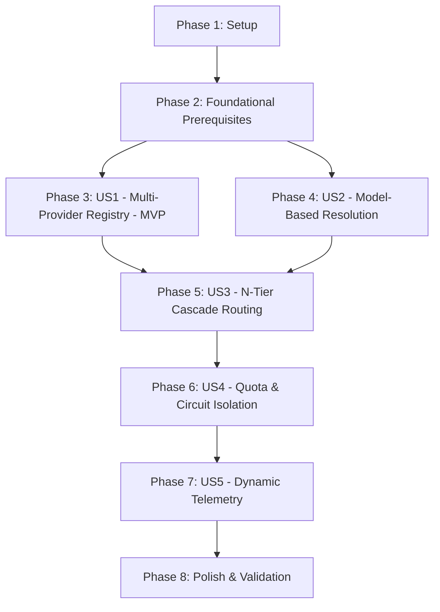

# Tasks: Provider-Agnostic Routing & Dynamic Model Cascade

**Input**: Design documents from `specs/007-provider-agnostic-routing/`  
**Prerequisites**: `plan.md`, `spec.md`, `research.md`, `data-model.md`, `contracts/`, `quickstart.md`  

---

## Format: `- [ ] [ID] [P?] [Story] Description with file path`

- **[P]**: Can run in parallel (different files, no dependencies)
- **[Story]**: Maps to user stories [US1]–[US5] from `spec.md`
- Every task includes an explicit, actionable file path

---

## Phase 1: Setup (Shared Infrastructure)

**Purpose**: Project declarations, CMake configuration, and shared type definitions

- [x] T001 [P] Declare ProviderConfig, CascadeTarget, and CascadeRoute structures in `include/tessera/routing/circuit_types.hpp`
- [x] T002 [P] Update build targets and add new test executables in `CMakeLists.txt`

---

## Phase 2: Foundational (Blocking Prerequisites)

**Purpose**: Core infrastructure prerequisites that block all user stories

**⚠️ CRITICAL**: No user story work can begin until this foundational phase is complete

- [x] T003 Implement ProviderConfig validation and default circuit breaker settings in `include/tessera/routing/circuit_types.hpp`
- [x] T004 [P] Update TelemetryRegistry to dynamically instantiate provider gauges and histograms on demand in `include/tessera/telemetry/telemetry_registry.hpp` and `src/telemetry/telemetry_registry.cpp`
- [x] T005 [P] Implement dynamic provider quota resolution in RateLimitedBackend in `include/tessera/ratelimit/rate_limited_backend.hpp` and `src/ratelimit/rate_limited_backend.cpp`

**Checkpoint**: Foundational types, telemetry, and rate limiting abstractions ready.

---

## Phase 3: User Story 1 - Dynamic Multi-Provider Registration & Extensibility (Priority: P1) 🎯 MVP

**Goal**: Operators can register arbitrary upstream AI providers (local Ollama/vLLM, cloud APIs) via configuration without code changes or recompilation.

**Independent Test**: Register a custom local provider in configuration; dispatch a request to it and verify successful response without modifying gateway source code.

### Tests for User Story 1
- [x] T006 [P] [US1] Unit test verifying ProviderRegistry registration, environment parsing, and default fallback in `tests/unit/test_provider_registry.cpp`

### Implementation for User Story 1
- [x] T007 [P] [US1] Define ProviderRegistry interface and catalog state in `include/tessera/routing/provider_registry.hpp`
- [x] T008 [US1] Implement ProviderRegistry, environment variable parser (`TESSERA_PROVIDERS`, `PROVIDER_<NAME>_*`), and catalog lookup in `src/routing/provider_registry.cpp`
- [x] T009 [US1] Update HttpUpstreamClient to omit Authorization header when API key is empty (for local models) in `src/backend/upstream_client.cpp`
- [x] T010 [US1] Integrate ProviderRegistry loading and provider status banner into server initialization in `src/main.cpp`

**Checkpoint**: User Story 1 complete. Arbitrary providers can be registered and accessed via configuration.

---

## Phase 4: User Story 2 - Model-Based Dynamic Upstream Resolution (Priority: P1)

**Goal**: Requests specifying model identifiers automatically route to the corresponding provider backend or alias mapping.

**Independent Test**: Dispatch requests specifying different model names (`deepseek-chat`, `llama3.2`, `llama-3.1-8b-instant`) and verify each routes to its respective provider.

### Tests for User Story 2
- [x] T011 [P] [US2] Unit test verifying ModelRouter exact match, wildcard prefix matching (`ollama/*`), and default cascade in `tests/unit/test_model_router.cpp`

### Implementation for User Story 2
- [x] T012 [P] [US2] Define ModelRouter interface and model routing rule structures in `include/tessera/routing/model_router.hpp`
- [x] T013 [US2] Implement model mapping table, provider prefix resolution, and cycle detection in `src/routing/model_router.cpp`
- [x] T014 [US2] Integrate ModelRouter resolution (as ICompletionBackend) with ChatCompletionRequest pipeline in `src/server/gateway_server.cpp` and `src/main.cpp`

**Checkpoint**: User Story 2 complete. Client requests dynamically resolve target providers based on model names.

---

## Phase 5: User Story 3 - $N$-Tier Priority Fallback Cascade with Zero-Loss Recovery (Priority: P2)

**Goal**: Requests automatically fail over through an ordered chain of $N$ alternative providers upon 429 quota exhaustion or 5xx errors with zero dropped requests.

**Independent Test**: Inject failures on primary and secondary providers in a 3-tier cascade and verify request transparently recovers on the tertiary provider.

### Tests for User Story 3
- [x] T015 [P] [US3] Unit test verifying CascadeRouter multi-tier traversal, circuit state bypass, and exhausted errors in `tests/unit/test_cascade_router.cpp`
- [x] T016 [P] [US3] Integration test simulating chaos 429/5xx faults across 3 providers with zero dropped calls and verifying cache preemption bypass in `tests/integration/test_multi_provider_cascade.cpp`

### Implementation for User Story 3
- [x] T017 [P] [US3] Define CascadeRouter interface and CascadeTarget specification in `include/tessera/routing/cascade_router.hpp`
- [x] T018 [US3] Implement N-tier sequential cascade execution, transparent retry, and model remapping in `src/routing/cascade_router.cpp`
- [x] T019 [US3] Refactor FailoverRouter as a backward-compatible 2-tier adapter delegating to CascadeRouter in `include/tessera/routing/failover_router.hpp` and `src/routing/failover_router.cpp`

**Checkpoint**: User Story 3 complete. Full $N$-tier fallback routing operational with zero loss across outages.

---

## Phase 6: User Story 4 - Isolated Per-Provider Circuit Breakers & Quotas (Priority: P2)

**Goal**: Each registered provider has independent circuit breaker and rate limiting quotas so outages on one provider do not impact others.

**Independent Test**: Exhaust quota on Provider A and verify Provider B concurrently processes requests at full throughput without throttling.

### Tests for User Story 4
- [x] T020 [P] [US4] Integration test verifying concurrent quota isolation and independent breaker tripping in `tests/integration/test_provider_rate_isolation.cpp`

### Implementation for User Story 4
- [x] T021 [US4] Wire per-provider circuit breaker instantiation and rate limit rule registration in `src/routing/provider_registry.cpp`
- [x] T022 [US4] Ensure Redis Lua token bucket rate limiter dynamically registers and isolates keys per provider (`ratelimit:<provider>:<window>`) in `src/ratelimit/rate_limiter.cpp`

**Checkpoint**: User Story 4 complete. Full fault and quota isolation established across all providers.

---

## Phase 7: User Story 5 - Dynamic Observability & Multi-Provider Telemetry (Priority: P3)

**Goal**: Request metrics, circuit states, and latency histograms are dynamically instrumented and labeled by provider name.

**Independent Test**: Query Prometheus metrics endpoint and verify dynamic metric labels for all registered providers.

### Tests for User Story 5
- [x] T023 [P] [US5] Unit test verifying dynamic multi-provider metrics exposition in `tests/unit/test_telemetry.cpp`

### Implementation for User Story 5
- [x] T024 [US5] Implement dynamic label emission in TelemetryRegistry::ToPrometheusFormat for all active providers in `src/telemetry/telemetry_registry.cpp`
- [x] T025 [US5] Update Prometheus exposition format validator script to accept dynamic provider names in `scripts/verify_metrics_format.sh`

**Checkpoint**: User Story 5 complete. Real-time telemetry dynamically tags all backends.

---

## Phase 8: Polish & Cross-Cutting Concerns

**Purpose**: Documentation, configuration examples, and end-to-end verification

- [x] T026 [P] Update `.env.example` and `README.md` with multi-provider environment configuration syntax in `.env.example` and `README.md`
- [x] T027 [P] Update `ROADMAP.md` documenting provider-agnostic cascade capabilities in `ROADMAP.md`
- [x] T028 Execute full quickstart validation scenarios under ASan/UBSan per `specs/007-provider-agnostic-routing/quickstart.md`

---

## Dependencies & Execution Order

### Phase Dependencies

### User Story Dependencies

* **US1 (P1)**: Depends on Phase 2. Can be implemented and verified independently (MVP).
* **US2 (P1)**: Depends on Phase 2. Maps models to providers registered in US1.
* **US3 (P2)**: Depends on US1 and US2. Traverses multi-provider cascade chains.
* **US4 (P2)**: Depends on US3. Enforces isolated quotas and circuit states per cascade stage.
* **US5 (P3)**: Depends on US4. Observes and exposes telemetry across all active providers.

---

## Parallel Opportunities

* **Setup**: T001 and T002 can run in parallel.
* **Foundational**: T004 and T005 can run in parallel.
* **US1**: T006 (unit test) and T007 (header definition) can run in parallel.
* **US2**: T011 (unit test) and T012 (header definition) can run in parallel.
* **US3**: T015 (unit test), T016 (integration test), and T017 (header definition) can run in parallel.
* **US4**: T020 (integration test) can be authored in parallel with US3 implementation.
* **US5**: T023 (unit test) can run in parallel with telemetry updates.
* **Polish**: T026 and T027 can run in parallel.

---

## Implementation Strategy

### MVP Milestone (Phase 1, 2, and 3)
1. Complete Setup and Foundational tasks (T001–T005).
2. Complete User Story 1 (T006–T010).
3. **Verify MVP**: Register a custom provider in `.env` (e.g. local Ollama at `http://localhost:11434/v1/chat/completions`) and confirm the gateway dispatches to it without code changes.

### Incremental Delivery (Phases 4 through 8)
1. Deliver User Story 2 (Model-based routing) $\rightarrow$ enables `model: "deepseek-chat"`.
2. Deliver User Story 3 ($N$-tier cascade) $\rightarrow$ enables 3+ provider fallback chains.
3. Deliver User Story 4 (Quota isolation) $\rightarrow$ ensures saturated providers do not throttle healthy tiers.
4. Deliver User Story 5 (Dynamic telemetry) $\rightarrow$ full observability in Prometheus.
5. Polish, documentation, and ASan/UBSan clean execution check.
