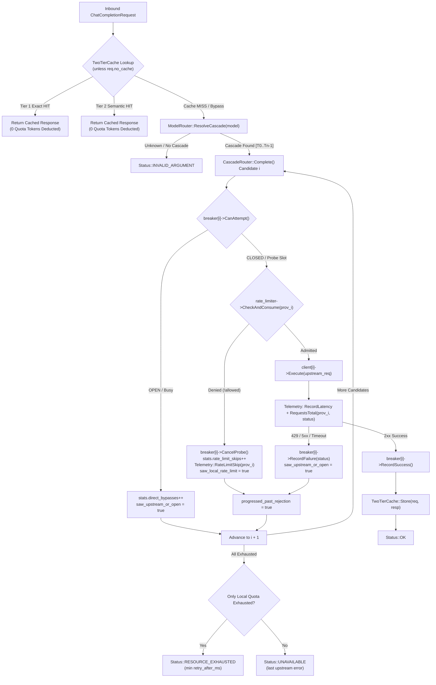
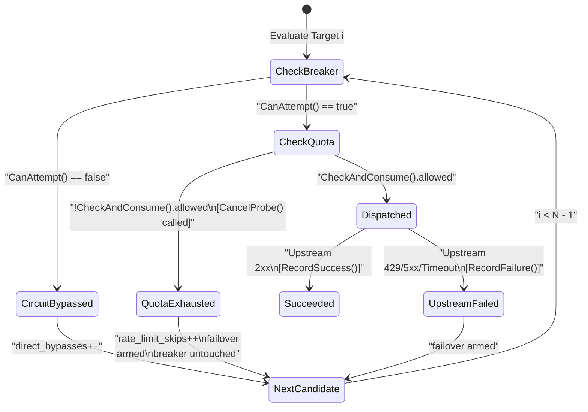

# Data Model & State Transitions: Cache-First Pipeline Ordering & Quota-Aware Cascade Failover

**Feature**: `008-cache-first-quota-cascade`  
**Date**: 2026-11-25  
**Spec Reference**: [spec.md](spec.md)

---

## 1. End-to-End Pipeline Topology

---

## 2. Modified & Extended Entities

### 2.1 `CascadeTarget` ([`include/tessera/routing/circuit_types.hpp`](file:///home/mayukh/projects/tessera/include/tessera/routing/circuit_types.hpp))

Represents an individual candidate stage inside a cascade chain.

| Field | Type | Default | Semantics |
|---|---|---|---|
| `client` | `std::shared_ptr<IUpstreamClient>` | `nullptr` | Upstream OpenAI-compatible client adapter |
| `breaker` | `std::shared_ptr<ICircuitBreaker>` | `nullptr` | Provider-isolated 3-state circuit breaker |
| `target_model` | `std::string` | `""` | Optional model identifier override forwarded to provider |
| `priority` | `uint32_t` | `0` | Evaluation priority order (0 = highest priority) |
| `rate_limiter` | `std::shared_ptr<DistributedRateLimiter>` | `nullptr` | Optional per-target rate limiter overriding cascade-level limiter |

### 2.2 `CascadeRouterStats` ([`include/tessera/routing/cascade_router.hpp`](file:///home/mayukh/projects/tessera/include/tessera/routing/cascade_router.hpp))

Counters snapshot exposing granular cascade behavior across failover, circuit skips, and local quota skips.

| Field | Type | Semantics |
|---|---|---|
| `total_requests` | `uint64_t` | Total invocations entering `CascadeRouter::Complete()` |
| `successful_requests` | `uint64_t` | Requests completed with HTTP 2xx on any candidate tier |
| `failed_requests` | `uint64_t` | Requests failing after exhausting all tiers |
| `failover_attempts` | `uint64_t` | Candidate transitions triggered after an upstream error OR a local rate-limit skip |
| `direct_bypasses` | `uint64_t` | Candidate skips caused by `breaker->CanAttempt() == false` |
| `rate_limit_skips` | `uint64_t` | **New**: Candidate skips caused by `rate_limiter->CheckAndConsume() == false` |
| `all_providers_failed` | `uint64_t` | Requests where every target in the route failed or was skipped |

### 2.3 `FailoverRouterStats` ([`include/tessera/routing/circuit_types.hpp`](file:///home/mayukh/projects/tessera/include/tessera/routing/circuit_types.hpp))

Preserves legacy 2-tier metrics while exposing local quota skip attribution:

| Field | Type | Semantics |
|---|---|---|
| `rate_limit_skips` | `uint64_t` (default `0`) | **New**: Cumulative local quota-triggered skips reported via underlying cascade |

### 2.4 `TelemetryRegistry` Counters ([`include/tessera/telemetry/telemetry_registry.hpp`](file:///home/mayukh/projects/tessera/include/tessera/telemetry/telemetry_registry.hpp))

Adds local rate-limit rejection attribution per provider cleanly separated from upstream network requests and latency histograms:

- `gateway_ratelimit_skips_total{provider="<name>"}` (`COUNTER`): Incremented via `IncrementRateLimitSkipsTotal(provider)` when local distributed quota prevents dispatching to `<name>`.

---

## 3. Tier Admission State Machine

