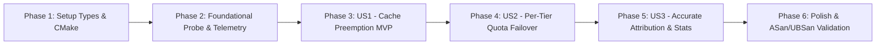

# Tasks: Cache-First Pipeline Ordering & Quota-Aware Cascade Failover

**Input**: Design documents from `specs/008-cache-first-quota-cascade/`  
**Prerequisites**: `plan.md`, `spec.md`, `research.md`, `data-model.md`, `contracts/pipeline_execution_contract.md`, `quickstart.md`

---

## Format: `- [ ] [ID] [P?] [Story?] Description with file path`

- **[P]**: Can run in parallel (different files, no dependencies on incomplete tasks)
- **[Story]**: Maps tasks to user stories (`[US1]`–`[US3]`) from `spec.md`
- **No Story Label**: Phase 1 (Setup), Phase 2 (Foundational), and Final Phase (Polish)

---

## Phase 1: Setup (Shared Infrastructure & Type Extensions)

**Purpose**: Extend shared cascade structs, stats snapshots, and CMake unit test registration.

- [ ] T001 [P] Extend `CascadeTarget` with optional `std::shared_ptr<DistributedRateLimiter> rate_limiter = nullptr` (keeping `priority = 0` default and `target_model` empty default) and add `uint64_t rate_limit_skips = 0` to `FailoverRouterStats` in `include/tessera/routing/circuit_types.hpp`
- [ ] T002 [P] Add `uint64_t rate_limit_skips = 0` to `CascadeRouterStats` and declare optional `std::shared_ptr<DistributedRateLimiter> rate_limiter = nullptr` constructor parameter and `SetRateLimiter()` method on `CascadeRouter` in `include/tessera/routing/cascade_router.hpp`
- [ ] T003 [P] Register new unit test file `tests/unit/test_cache_first_cascade.cpp` under the `unit_tests` target in `CMakeLists.txt`

---

## Phase 2: Foundational (Blocking Prerequisites)

**Purpose**: Core circuit probe cancellation and local quota-skip telemetry required by all user stories.

**⚠️ CRITICAL**: No user story work should begin until this foundational phase is complete.

- [ ] T004 [P] Add `virtual void CancelProbe() noexcept {}` to `ICircuitBreaker` in `include/tessera/routing/circuit_breaker.hpp` and override `CircuitBreaker::CancelProbe()` in `src/routing/circuit_breaker.cpp` (must reset `probe_in_flight_` to `false` only when `state_ == CircuitState::HALF_OPEN`, remaining a strict no-op in `CLOSED` or `OPEN` states)
- [ ] T005 [P] Add `IncrementRateLimitSkipsTotal(std::string_view provider)` and `GetRateLimitSkipsTotal(std::string_view provider)` to `TelemetryRegistry` in `include/tessera/telemetry/telemetry_registry.hpp`, pre-seed registered providers to `0` on `RegisterProvider()` and clear on `Reset()`, and emit `# HELP`/`# TYPE gateway_ratelimit_skips_total counter` and `gateway_ratelimit_skips_total{provider="<name>"}` samples cleanly in `ToPrometheusFormat()` inside `src/telemetry/telemetry_registry.cpp` (ensuring local skips never populate `upstream_latency_ms`)

**Checkpoint**: Foundational circuit safety and telemetry attribution APIs ready.

---

## Phase 3: User Story 1 - Zero-Quota Cache Preemption (Priority: P1) 🎯 MVP

**Goal**: Exact-match and semantic-match caches execute before rate-limit token deduction, serve hits with zero quota consumed even when primary quota is saturated, and index completions returned from fallback tiers.

**Independent Test**: Configure a strict primary quota (2 requests), warm exact + semantic caches with 1 request, exhaust remaining quota, replay cached + paraphrased queries and confirm `Status::OK()` (`cache_hit = true`) with 0 remaining token loss, while `no_cache` bypass hits the quota gate.

### Tests for User Story 1

> **NOTE: Write these tests FIRST and verify they fail before implementation changes**

- [ ] T006 [P] [US1] Create unit tests verifying Tier 1 exact cache hit, Tier 2 semantic cache hit, 0 quota tokens deducted even at 0 remaining tokens (confirming rate-limiter `CheckAndConsume` / `EvalRateLimitLua` invocation count stays unchanged on cache hits per SC-005), and mixed `no_cache = true` bypass alongside concurrent cached replays in `tests/unit/test_cache_first_cascade.cpp`
- [ ] T007 [P] [US1] Add integration test verifying fallback-tier completion (after Tier 1 quota/error failover) populates both cache tiers and subsequent replays consume 0 provider quota in `tests/integration/test_multi_provider_cascade.cpp`

### Implementation for User Story 1

- [ ] T008 [US1] Add `std::shared_ptr<DistributedRateLimiter> rate_limiter_` support, `SetRateLimiter()`, and `ModelRouter::CreateFromRegistry(const ProviderRegistry& registry, std::shared_ptr<DistributedRateLimiter> rate_limiter = nullptr)` forwarding `rate_limiter` to default and dedicated provider cascades in `include/tessera/routing/model_router.hpp` and `src/routing/model_router.cpp`
- [ ] T009 [US1] Restructure the server completion stack in `src/main.cpp` so `CachedCompletionBackend` wraps `ModelRouter::CreateFromRegistry(provider_registry, rate_limiter)` as the outermost backend (removing the outer pre-cache `RateLimitedBackend` wrapper) and update startup banner text to `Pipeline:   TwoTierCache -> ModelRouter (Quota-Aware Cascade)`

**Checkpoint**: User Story 1 (MVP) complete. Cache hits preempt all upstream quota deduction and serve traffic unimpeded under primary saturation.

---

## Phase 4: User Story 2 - Quota-Triggered Multi-Tier Cascade Failover (Priority: P1)

**Goal**: Per-provider distributed rate-limit enforcement executes individually per candidate tier inside `CascadeRouter`, transparently failing over across $N$ tiers upon local token-bucket depletion without dropped calls, while returning `StatusCode::RESOURCE_EXHAUSTED` with minimum retry-after timing when all tiers are quota-limited.

**Independent Test**: Configure 3-tier cascade (`Tier 1 cap=2 -> Tier 2 cap=2 -> Tier 3 cap=5`) and dispatch uncached burst traffic; verify 5/5+ completions succeed across tiers in strict priority order without overflowing any tier's bucket cap, and verify exhausted single-tier route returns `RESOURCE_EXHAUSTED` with `"Rate limit exceeded"` and `"Retry after <ms>ms"`.

### Tests for User Story 2

- [ ] T010 [P] [US2] Add unit tests verifying per-tier quota failover (`Tier 1 exhausted -> Tier 2 succeeds`), combined 3-tier `Tier 1 QUOTA_EXHAUSTED + Tier 2 OPEN circuit -> direct jump to Tier 3` recovery, zero token deduction when `breaker->CanAttempt() == false` (`OPEN`), `HALF_OPEN` `CancelProbe()` release on local quota exhaustion, fail-open behavior when rate-limiter store is unhealthy, and `Status::ResourceExhausted` return on all-quota exhaustion in `tests/unit/test_cascade_router.cpp`
- [ ] T011 [P] [US2] Add unit tests validating `ModelRouter::CreateFromRegistry(registry, rate_limiter)` enforces isolated quotas across model-specific and default cascade routes in `tests/unit/test_model_router.cpp`
- [ ] T012 [P] [US2] Add 3-tier concurrent burst quota-failover integration test verifying exact cumulative quota compliance (`T1=10, T2=15, T3=25`, 50 concurrent uncached requests -> 50/50 succeed with 0 dropped calls and exact per-tier dispatch counts) in `tests/integration/test_provider_rate_isolation.cpp`

### Implementation for User Story 2

- [ ] T013 [US2] Implement sequential per-candidate admission inside `CascadeRouter::Complete()` in `src/routing/cascade_router.cpp`: check `breaker->CanAttempt()` first (incrementing `direct_bypasses` without setting `progressed_past_rejection` and without consuming quota), evaluate `active_limiter->CheckAndConsume(prov_name, 1.0)` second (calling `breaker->CancelProbe()`, skipping `Execute()`, tracking `min_retry_after_ms`, setting `progressed_past_rejection = true`, and continuing to `i + 1` on denial), increment `failover_attempts` only when `progressed_past_rejection` is true, and return `Status::ResourceExhausted("Rate limit exceeded across all providers in route '" + route_id_ + "'. Retry after " + std::to_string(retry_ms) + "ms")` when only local quotas were exhausted or `Status::Unavailable` when upstream errors/open circuits occurred
- [ ] T014 [US2] Extend `FailoverRouter` constructor with optional `std::shared_ptr<DistributedRateLimiter> rate_limiter = nullptr`, forward it to the internal `CascadeRouter`, propagate `rate_limit_skips` stats, and preserve `StatusCode::RESOURCE_EXHAUSTED` returns in `include/tessera/routing/failover_router.hpp` and `src/routing/failover_router.cpp`

**Checkpoint**: User Story 2 complete. Local token-bucket depletion triggers zero-loss cascade failover with exact quota compliance and deadlock-free `HALF_OPEN` probing.

---

## Phase 5: User Story 3 - Accurate Failure Attribution & Telemetry Integrity (Priority: P2)

**Goal**: Local rate-limit skips never falsely trip upstream outage circuit breakers or pollute `upstream_latency_ms` histograms, while `gateway_ratelimit_skips_total` and `failover_attempts` accurately reflect execution vs. bypass vs. failover transitions.

**Independent Test**: Exhaust Provider A local quota in a 2-tier cascade (`Provider A -> Provider B`), run uncached failover queries, verify Provider A stays `CLOSED` with `0` upstream latency samples and `rate_limit_skips > 0`, `failover_attempts` increments, and Provider B receives upstream request/latency attribution.

### Tests for User Story 3

- [ ] T015 [P] [US3] Add unit tests verifying `IncrementRateLimitSkipsTotal` / `GetRateLimitSkipsTotal`, Prometheus `gateway_ratelimit_skips_total{provider="..."}` rendering, and `Reset()` cleanup in `tests/unit/test_telemetry.cpp`
- [ ] T016 [US3] Add unit tests asserting local rate-limit skips keep Tier 1 circuit `CLOSED` (0 false trips), avoid polluting `upstream_latency_ms` for skipped tiers, increment `rate_limit_skips` + `failover_attempts`, and do not double-count `failover_attempts` after pure `OPEN`-circuit `direct_bypasses` in `tests/unit/test_cascade_router.cpp` (depends on T010)

### Implementation for User Story 3

- [ ] T017 [US3] Wire `TelemetryRegistry::Instance().IncrementRateLimitSkipsTotal(prov_name)` on local quota skips inside `CascadeRouter::Complete()` in `src/routing/cascade_router.cpp` (depends on T005, T013)
- [ ] T018 [US3] Verify Prometheus format compliance and ensure `scripts/verify_metrics_format.sh` cleanly accepts `gateway_ratelimit_skips_total` alongside dynamic provider series in `scripts/verify_metrics_format.sh`

**Checkpoint**: User Story 3 complete. Telemetry, circuit states, and failover counters accurately separate local quota throttling from upstream outages.

---

## Phase 6: Polish & End-to-End Verification

**Purpose**: Final documentation alignment, compiler warning checks, and full ASan/UBSan quickstart verification.

- [ ] T019 [P] Verify pipeline diagram/notes and check if `evaluation_harness` / `quickstart.md` documentation aligns with Feature 008 behavior in `specs/008-cache-first-quota-cascade/quickstart.md`
- [ ] T020 Build all targets under Debug + ASan/UBSan (`-Wall -Wextra -Wpedantic -Wconversion -Wsign-conversion`) and execute full `ctest --test-dir build --output-on-failure` plus all quickstart validation scenarios from `specs/008-cache-first-quota-cascade/quickstart.md`

---

## Dependencies & Execution Order

### Phase Dependencies



### Story Independence & Dependency Notes

- **Phase 1 & 2 (Setup + Foundational)**: `T001`, `T002`, `T003`, `T004`, `T005` operate on independent headers/files and can execute largely in parallel before User Story work.
- **US1 (P1 MVP)**: Can be verified immediately via cache preemption tests (`T006`, `T007`) and pipeline reordering (`T008`, `T009`).
- **US2 (P1)**: Extends `CascadeRouter` and `FailoverRouter` per-tier admission (`T013`, `T014`) on top of `T001`/`T002`/`T004`; tests (`T010`–`T012`) verify failover correctness independently.
- **US3 (P2)**: Refines attribution and counters (`T017`, `T018`) layered cleanly atop `T005` and `T013`.

---

## Parallel Opportunities per Story

### Parallel Batch — Phase 1 & 2
```bash
# All independent header/build extensions can be applied in parallel:
T001: circuit_types.hpp
T002: cascade_router.hpp
T003: CMakeLists.txt
T004: circuit_breaker.hpp / circuit_breaker.cpp
T005: telemetry_registry.hpp / telemetry_registry.cpp
```

### Parallel Batch — US1 Tests (`T006` + `T007`)
```bash
T006: tests/unit/test_cache_first_cascade.cpp
T007: tests/integration/test_multi_provider_cascade.cpp
```

### Parallel Batch — US2 Tests (`T010` + `T011` + `T012`)
```bash
T010: tests/unit/test_cascade_router.cpp
T011: tests/unit/test_model_router.cpp
T012: tests/integration/test_provider_rate_isolation.cpp
```

---

## Implementation Strategy

### MVP First (Through Phase 3 / US1)
1. Finish Phase 1 (`T001`–`T003`) and Phase 2 (`T004`–`T005`).
2. Complete Phase 3 (`T006`–`T009`) to reorder `CachedCompletionBackend` ahead of `ModelRouter` and pass `rate_limiter` via `ModelRouter::CreateFromRegistry`.
3. Validate **SC-001** (0 quota deducted on cache hits under saturated primary quota).

### Full Feature Delivery (Phases 4–6)
4. Implement per-tier admission inside `CascadeRouter::Complete()` and `FailoverRouter` (`T010`–`T014`), validating **SC-002** and **SC-003**.
5. Finalize telemetry & attribution refinements (`T015`–`T018`), validating **SC-004**.
6. Run full ASan/UBSan test matrix and quickstart scenarios (`T019`–`T020`), verifying **SC-005** and **SC-006**.
