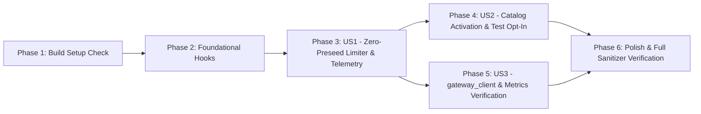

# Tasks: Zero-Preseed Provider Limiter & Telemetry Initialization

**Input**: Design documents from `/specs/009-zero-preseed-providers/`  
**Prerequisites**: [plan.md](file:///home/mayukh/projects/tessera/specs/009-zero-preseed-providers/plan.md) (required), [spec.md](file:///home/mayukh/projects/tessera/specs/009-zero-preseed-providers/spec.md) (required), [research.md](file:///home/mayukh/projects/tessera/specs/009-zero-preseed-providers/research.md), [data-model.md](file:///home/mayukh/projects/tessera/specs/009-zero-preseed-providers/data-model.md), [zero_preseed_contract.md](file:///home/mayukh/projects/tessera/specs/009-zero-preseed-providers/contracts/zero_preseed_contract.md), [quickstart.md](file:///home/mayukh/projects/tessera/specs/009-zero-preseed-providers/quickstart.md)

**Tests**: Explicitly included per specification (`FR-010`, `FR-011`) and Tessera Constitution Principle IV (all modules verified under Debug + ASan/UBSan and Prometheus validation scripts).

**Organization**: Tasks are grouped by user story in priority order (`US1` -> `US2` -> `US3`) so each story is independently implementable and testable.

## Format: `[ID] [P?] [Story] Description`

- **[P]**: Can execute in parallel (independent files, no incomplete task dependencies)
- **[Story]**: User story label (`US1`, `US2`, `US3`) for story phases only
- Every task includes exact target file paths and key constraints from `data-model.md` / `contracts/zero_preseed_contract.md`

---

## Phase 1: Setup (Shared Infrastructure)

**Purpose**: Verify baseline toolchain configuration and build cleanliness prior to edits.

- [ ] T001 Verify Debug + ASan/UBSan Ninja build configuration (`-Wall -Wextra -Wpedantic -Wconversion -Wsign-conversion -fsanitize=address,undefined`) and baseline CTest targets in `CMakeLists.txt`

---

## Phase 2: Foundational (Blocking Prerequisites)

**Purpose**: Small router and catalog interface extensions required by downstream catalog tests (`US2`) and `gateway_client` pipeline wiring (`US3`).

**⚠️ CRITICAL**: Complete this phase before `T011` and `T016`.

- [ ] T002 [P] Extend `ProviderRegistry::LoadFromEnvironment(bool preseed_defaults = true, ClientFactory custom_client_factory = nullptr)` so an optional `ClientFactory` is installed via `SetClientFactory()` prior to env discovery and provider registration (zero providers registered when `preseed_defaults == false` and no provider env vars exist) in `include/tessera/routing/provider_registry.hpp` and `src/routing/provider_registry.cpp`
- [ ] T003 [P] Add thread-safe `[[nodiscard]] std::shared_ptr<CascadeRouter> GetDefaultCascade() const;` accessor returning `default_cascade_` (`nullptr` when unset) on `ModelRouter` in `include/tessera/routing/model_router.hpp` and `src/routing/model_router.cpp`

**Checkpoint**: Shared factory and accessor hooks ready; user story work can proceed.

---

## Phase 3: User Story 1 - Zero-Preseed Rate Limiter & Telemetry Initialization and Reset (Priority: P1) 🎯 MVP

**Goal**: Freshly constructed `DistributedRateLimiter` and freshly initialized/`Reset()` `TelemetryRegistry` instances start completely empty without unconditionally pre-seeding `groq` or `openrouter` rules, circuit gauges, latency histograms, or skip counters, while keeping read queries non-mutating and write queries lazy-creating as needed.

**Independent Test**: Construct a default `DistributedRateLimiter(pool)` with no catalog entries -> verify `HasRules("groq") == false`, `HasRules("openrouter") == false`, and unconstrained pass-through; construct and `Reset()` `TelemetryRegistry` -> verify `GetTrackedProviders().empty() == true`, non-mutating reads, and 0 `groq`/`openrouter` rows in `ToPrometheusFormat()`.

### Tests for User Story 1

> **NOTE: Add assertions verifying zero-preseed behavior alongside the US1 changes cleanly**

- [ ] T004 [P] [US1] Add unit tests verifying default `DistributedRateLimiter(pool)` starts with `HasRules("groq") == false`, `HasRules("openrouter") == false`, empty `GetRules(...)` vectors, unconstrained `CheckAndConsume()` pass-through (0 Redis Lua evaluations for unconfigured providers), and empty `ClearAllRules()` without re-seeding in `tests/unit/test_rate_limiter.cpp`
- [ ] T005 [P] [US1] Add unit tests verifying `TelemetryRegistry` at initialization and immediately after `Reset()` has `GetTrackedProviders().empty() == true`, omits all `groq` and `openrouter` series from `ToPrometheusFormat()`, keeps read-only queries (`GetCircuitBreakerState`, `GetRequestsTotal`, `GetRateLimitSkipsTotal`, `GetUpstreamLatencySnapshot`) non-mutating without inserting phantom entries, and preserves lazy series creation on active writes in `tests/unit/test_telemetry.cpp`

### Implementation for User Story 1

- [ ] T006 [P] [US1] Remove unconditional `LoadStandardPolicies()` from `DistributedRateLimiter::DistributedRateLimiter(std::shared_ptr<RedisConnectionPool> redis_pool, bool load_standard_policies = false)` (invoking `LoadStandardPolicies()` only when `load_standard_policies == true`), keeping empty init and `ClearRules()` / `ClearAllRules()` free of vendor pre-seeding in `include/tessera/ratelimit/rate_limiter.hpp` and `src/ratelimit/rate_limiter.cpp`
- [ ] T007 [P] [US1] Remove hardcoded `"groq"` and `"openrouter"` map pre-seeding from `TelemetryRegistry::TelemetryRegistry()` and `TelemetryRegistry::Reset()` (clearing all four maps cleanly and zeroing cache atomics without inserting phantom entries, keeping `const` reads non-mutating and write methods lazy) in `src/telemetry/telemetry_registry.cpp`

**Checkpoint**: User Story 1 (MVP) complete. Limiter and telemetry initialization/reset paths emit zero hardcoded Groq/OpenRouter state.

---

## Phase 4: User Story 2 - Catalog-Driven Provider Activation & Explicit Test Preset Opt-In (Priority: P1)

**Goal**: Active rate-limit rules and initial telemetry series activate exclusively for providers configured via `ProviderRegistry`, while preserving explicit opt-in helpers (`LoadStandardPolicies()`, `TelemetryRegistry::RegisterStandardProviders()`) for standalone unit and concurrency tests.

**Independent Test**: Register custom providers (`ollama`, `deepseek`) through `ProviderRegistry` with an empty `DistributedRateLimiter` and reset `TelemetryRegistry`, verifying exclusively `{ollama, deepseek}` appear in rules and Prometheus output; independently invoke `LoadStandardPolicies()` and `RegisterStandardProviders()` in standalone unit/concurrency tests cleanly.

### Tests for User Story 2

- [ ] T008 [P] [US2] Update existing Groq/OpenRouter unit tests (`InitialQuotaPermitsRequests`, `DepletionRejectsSubsequentRequests`, `ProviderQuotasAreIsolated`, `FailOpenWhenRedisDown`, `RateLimitedBackendEnforcesLimit`, `CustomProviderResolverOverride`) to explicitly invoke `rate_limiter_->LoadStandardPolicies()` (or `(redis_pool_, true)`) and assert opt-in rule population in `tests/unit/test_rate_limiter.cpp` (depends on T006)
- [ ] T009 [P] [US2] Update standalone rate-limit concurrency tests (`ExactQuotaUnder200Threads`, `MultiProviderConcurrencyUnder200Threads`) in `tests/integration/test_ratelimit_concurrency.cpp` and Redis resilience setup in `tests/integration/test_redis_resilience.cpp` to explicitly call `LoadStandardPolicies()` on clean `DistributedRateLimiter` instances (depends on T006)
- [ ] T010 [P] [US2] Add unit test coverage for explicit `TelemetryRegistry::Instance().RegisterStandardProviders()` confirming on-demand pre-seeding of `"groq"` and `"openrouter"` gauges/histograms/skips while `Reset()` removes them cleanly in `tests/unit/test_telemetry.cpp` (depends on T007, T012)
- [ ] T011 [P] [US2] Add unit tests verifying `ProviderRegistry` with custom-only env/declarative registration (`ollama`, `deepseek`) populates rules in `DistributedRateLimiter` and series in `TelemetryRegistry` exclusively for `{ollama, deepseek}` with 0 `groq`/`openrouter` entries, plus `LoadFromEnvironment(preseed_defaults, custom_client_factory)` custom factory invocation in `tests/unit/test_provider_registry.cpp` (depends on T002, T006, T007, T013)

### Implementation for User Story 2

- [ ] T012 [P] [US2] Add `void RegisterStandardProviders();` opt-in helper declaration and definition calling `RegisterProvider("groq")` and `RegisterProvider("openrouter")` ONLY on explicit invocation in `include/tessera/telemetry/telemetry_registry.hpp` and `src/telemetry/telemetry_registry.cpp` (depends on T007)
- [ ] T013 [P] [US2] Ensure `ProviderRegistry::RegisterProvider()`, `SetRateLimiter()`, and `RegisterRateLimits()` apply `config.rate_limits` idempotently without duplicating rules on repeated attachment and propagate only registered providers to `TelemetryRegistry::RegisterProvider(lower_name)` in `src/routing/provider_registry.cpp`

**Checkpoint**: User Story 2 complete. Provider configuration is the exclusive activation path in production; standalone tests remain deterministic via explicit opt-in helpers.

---

## Phase 5: User Story 3 - Provider-Catalog Pipeline in `gateway_client` & Full Gate Verification (Priority: P2)

**Goal**: Migrate `gateway_client` from legacy `FailoverRouter` + outer `RateLimitedBackend(..., "groq")` wiring to `ProviderRegistry` + `DistributedRateLimiter` + `ModelRouter::CreateFromRegistry()` + cache-first `CachedCompletionBackend`, keeping CLI diagnostic options, offline smoke mode, custom `TESSERA_PROVIDERS` execution, and Prometheus format verification passing.

**Independent Test**: Run `./build/gateway_client` with `TESSERA_PROVIDERS=ollama,deepseek` + `--metrics` -> completes cleanly and exports zero `groq`/`openrouter` series; run `./build/gateway_client --health`, `--failover-demo --metrics`, and `bash scripts/verify_metrics_format.sh` in default offline env -> all exit `0` cleanly.

### Tests for User Story 3

- [ ] T014 [P] [US3] Add integration test verifying catalog-exclusive initialization (`TelemetryRegistry::Instance().Reset()` + `ProviderRegistry` with custom non-Groq/non-OpenRouter providers + empty `DistributedRateLimiter` + `ModelRouter::CreateFromRegistry`) emits zero `groq` or `openrouter` series in `ToPrometheusFormat()` in `tests/integration/test_provider_rate_isolation.cpp` (depends on T006, T007)
- [ ] T015 [P] [US3] Verify Prometheus exposition assertions in `scripts/verify_metrics_format.sh` against the refactored `gateway_client --metrics` under both unconfigured offline mock defaults and explicit `TESSERA_PROVIDERS` overrides in `scripts/verify_metrics_format.sh` (depends on T016)

### Implementation for User Story 3

- [ ] T016 [US3] Refactor `tools/gateway_client.cpp` to construct its stack via `ProviderRegistry::LoadFromEnvironment(true, client_factory)` (preserving `--groq-key`, `--openrouter-key`, optional `--live` mode for unkeyed local endpoints, `MockUpstreamClient` fallback when `(cfg.api_key.empty() && !live_mode) || failover_demo`, and simulated `429` injection on Tier 0 when `--failover-demo` is enabled with a clear warning if `ProviderCount() < 2`), empty `DistributedRateLimiter(redis_pool)` + `provider_registry.RegisterRateLimits(*rate_limiter)`, `ModelRouter::CreateFromRegistry(provider_registry, rate_limiter)` (selecting first provider `default_model` or `"auto"` when `--failover-demo` with >=2 providers and no explicit `--model`), and cache-first `CachedCompletionBackend(model_router, two_tier_cache)`—removing legacy `FailoverRouter` and outer `RateLimitedBackend`, and printing generic `CascadeRouterStats` via `model_router->GetDefaultCascade()` alongside all registered providers' `CircuitState` in `tools/gateway_client.cpp` (depends on T002, T003, T006, T007)

**Checkpoint**: User Story 3 complete. `gateway_client` and server share unified provider-agnostic, cache-first, zero-preseed architecture.

---

## Phase 6: Polish & End-to-End Verification

**Purpose**: Final documentation alignment, compiler cleanliness check, and complete ASan/UBSan + CLI verification.

- [ ] T017 [P] Update [quickstart.md](file:///home/mayukh/projects/tessera/specs/009-zero-preseed-providers/quickstart.md) status and commands after validation execution in `specs/009-zero-preseed-providers/quickstart.md`
- [ ] T018 Build all targets cleanly under Debug + ASan/UBSan (`-Wall -Wextra -Wpedantic -Wconversion -Wsign-conversion`) with 0 warnings/errors, run full `ctest --test-dir build --output-on-failure` across `unit_tests`, `integration_tests`, `ratelimit_concurrency_test`, and `concurrency_test`, run `bash scripts/verify_metrics_format.sh`, and run all `gateway_client` CLI smoke scenarios (`--health`, `--failover-demo --metrics`, `--no-cache`, and custom `TESSERA_PROVIDERS` asserting zero `groq`/`openrouter` metrics)

---

## Dependencies & Execution Order

### Phase Dependencies



### Parallel Opportunities

- **Phase 2**: `T002` (`provider_registry.*`) and `T003` (`model_router.*`) modify separate headers/sources and execute in parallel.
- **Phase 3 (US1 MVP)**: `T004`, `T005`, `T006` (`rate_limiter.*`), and `T007` (`telemetry_registry.cpp`) operate across disjoint files/modules (`T004`/`T005` validate `T006`/`T007`).
- **Phase 4 (US2)**: Once `T006` and `T007` complete, `T008`, `T009`, `T011`, `T012`, and `T013` can execute in parallel (`T010` follows `T012`).
- **Phase 5 (US3)**: `T014` (`test_provider_rate_isolation.cpp`) and `T016` (`tools/gateway_client.cpp`) can run in parallel once Phase 2 & Phase 3 complete, followed by `T015`.

---

## Parallel Example: User Story 1 + Phase 2

```bash
# Phase 2 hooks in parallel:
T002: include/tessera/routing/provider_registry.hpp + src/routing/provider_registry.cpp
T003: include/tessera/routing/model_router.hpp + src/routing/model_router.cpp

# US1 core zero-preseed changes in parallel:
T006: include/tessera/ratelimit/rate_limiter.hpp + src/ratelimit/rate_limiter.cpp
T007: src/telemetry/telemetry_registry.cpp
```

---

## Implementation Strategy

### MVP First (User Story 1)
1. Run `T001` baseline check and complete `T002`–`T003` foundational interfaces.
2. Execute `T004`–`T007` (User Story 1) so `DistributedRateLimiter` and `TelemetryRegistry` start/reset with zero hardcoded vendors.
3. Verify `RateLimiterTest` and `TelemetryTest` zero-preseed behavior immediately.

### Incremental Delivery
1. Apply **US2 (`T008`–`T013`)** so existing Groq/OpenRouter unit & concurrency tests opt in explicitly while custom-only `ProviderRegistry` registrations enforce catalog-exclusive parity.
2. Apply **US3 (`T014`–`T016`)** so `gateway_client` uses `ProviderRegistry + ModelRouter + CachedCompletionBackend` and passes `scripts/verify_metrics_format.sh` cleanly.
3. Run **Phase 6 (`T017`–`T018`)** full ASan/UBSan CTest, CLI smoke, and Prometheus validation gates.
