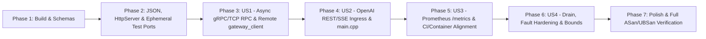

# Tasks: Live Network Ingress (gRPC, OpenAI REST/SSE & Prometheus Metrics)

**Input**: Design documents from `/specs/010-live-network-ingress/`  
**Prerequisites**: [plan.md](file:///home/mayukh/projects/tessera/specs/010-live-network-ingress/plan.md) (required), [spec.md](file:///home/mayukh/projects/tessera/specs/010-live-network-ingress/spec.md) (required), [research.md](file:///home/mayukh/projects/tessera/specs/010-live-network-ingress/research.md), [data-model.md](file:///home/mayukh/projects/tessera/specs/010-live-network-ingress/data-model.md), [live_ingress_contract.md](file:///home/mayukh/projects/tessera/specs/010-live-network-ingress/contracts/live_ingress_contract.md), [quickstart.md](file:///home/mayukh/projects/tessera/specs/010-live-network-ingress/quickstart.md)

**Tests**: Explicitly included per specification (`FR-009`, `FR-010`) and Tessera Constitution Principle IV (all network ingress, OpenAI REST/SSE, draining, and fault paths verified under Debug + ASan/UBSan and `verify_metrics_format.sh`).

**Organization**: Tasks are grouped by user story in priority order (`US1` -> `US2` -> `US3` -> `US4`) so each increment is independently buildable and testable.

## Format: `[ID] [P?] [Story] Description`

- **[P]**: Can execute in parallel (independent files, no incomplete task dependencies)
- **[Story]**: User story label (`US1`, `US2`, `US3`, `US4`) for story phases only
- Every task cites exact file paths and constraints from `data-model.md` / `contracts/live_ingress_contract.md`

---

## Phase 1: Setup (Build & Wire Schema Extensions)

**Purpose**: Register new modular source/test targets and extend shared config and Protobuf wire schemas.

- [x] T001 Register `src/common/json.cpp`, `src/server/http_server.cpp`, `src/server/rpc_server.cpp`, `src/server/rpc_client.cpp`, `tests/unit/test_json.cpp`, and `tests/integration/test_live_ingress.cpp` in `CMakeLists.txt`
- [x] T002 [P] Extend `protos/gateway.proto` with backward-compatible proto3 fields `bool no_cache = 7;` on `ChatCompletionRequest` and `bool cache_hit = 7; string cache_tier = 8;` on `ChatCompletionResponse` in `protos/gateway.proto`
- [x] T003 [P] Extend `ServerConfig` with `http_port{8080}`, `metrics_port{9090}`, `enable_rpc_listener{true}`, `enable_http_listener{true}`, and `enable_metrics_listener{true}` (keeping `port{50051}`, `max_message_size{4 * 1024 * 1024}`, and `graceful_drain_timeout_ms{5000}`) in `include/tessera/server/server_config.hpp`

---

## Phase 2: Foundational (JSON Codec, Reusable `HttpServer`, & Ephemeral Port Test Isolation)

**Purpose**: Core JSON parsing/serialization, reusable HTTP/1.1 + SSE server primitive, and collision-free ephemeral port configuration for parallel CTest execution.

**⚠️ CRITICAL**: Complete this phase before `US1`–`US4` implementation and network integration tests.

- [x] T004 [P] Implement depth-bounded recursive-descent `JsonValue` AST, strict parser, escaped serializer, and OpenAI JSON/error conversion helpers (rejecting malformed, truncated, or over-nested payloads) in `include/tessera/common/json.hpp` and `src/common/json.cpp`
- [x] T005 Add unit tests verifying JSON object/array parsing, escape decoding/encoding (`\"`, `\\`, `\n`, `\r`, `\t`, `\uXXXX`), nesting-depth/truncation rejection, and OpenAI completion request/response JSON conversions in `tests/unit/test_json.cpp` (depends on T004)
- [x] T006 [P] Implement reusable RAII `HttpServer` (`SO_REUSEADDR`, ephemeral `port == 0` -> `BoundPort()`, `poll()` + shutdown self-pipe wakeup, worker thread pool, per-socket timeouts, `max_body_bytes` cap returning `413` before buffering, `MSG_NOSIGNAL` chunked/SSE response streaming writer) in `include/tessera/server/http_server.hpp` and `src/server/http_server.cpp` (depends on T004)
- [x] T007 [P] Update existing in-process integration fixtures (`ServerAsyncIntegrationTest`, `GracefulShutdownTest`, `ConcurrencyIntegrationTest`, `ValidationIntegrationTest`) to bind ephemeral listener ports (`port = 0`, `http_port = 0`, `metrics_port = 0`) so parallel `ctest --parallel` runs never encounter bind collisions in `tests/integration/test_server_async.cpp`, `tests/integration/test_graceful_shutdown.cpp`, `tests/integration/test_concurrency.cpp`, and `tests/integration/test_validation_integration.cpp` (depends on T003)

**Checkpoint**: Shared JSON codec, reusable HTTP server primitive, and parallel-safe test ports ready.

---

## Phase 3: User Story 1 - Real Async gRPC & Fallback TCP RPC Ingress + Remote `gateway_client` (Priority: P1) 🎯 MVP

**Goal**: Replace `GatewayServer`'s idle `WorkerLoop` sleeps with a live network RPC listener on `GATEWAY_PORT` (`50051`) supporting native async gRPC (`TESSERA_HAS_SYSTEM_GRPC`) or framed TCP JSON RPC fallback, and refactor `gateway_client` into a true remote client dialing the running server.

**Independent Test**: Start `GatewayServer` on ephemeral `BoundPort()`, execute remote `RpcClient` + `gateway_client --health`, `--message`, and `--no-cache` over loopback TCP/gRPC, verify live completion responses & correlation IDs, and verify non-zero exit when server stops.

### Tests for User Story 1

- [x] T008 [US1] Create live loopback network integration test suite file adding remote RPC completion, `--no-cache` propagation, remote health check (`SERVING` while running -> failure after `Stop()`), oversized RPC frame rejection, and connection-refused assertions using ephemeral `BoundPort()` in `tests/integration/test_live_ingress.cpp` (depends on T001, T007)

### Implementation for User Story 1

- [x] T009 [P] [US1] Implement `RpcServer` supporting `#ifdef TESSERA_HAS_SYSTEM_GRPC` asynchronous `GatewayService::AsyncService` + `ServerCompletionQueue` state machine AND `#else` length-prefixed (`uint32_t` big-endian <= `max_message_size + 65536`) UTF-8 JSON TCP RPC server on `host:port` (supporting ephemeral `port = 0` -> `BoundPort()`, `max_message_size`, and clean stop/unblock) in `include/tessera/server/rpc_server.hpp` and `src/server/rpc_server.cpp` (depends on T002, T003, T004)
- [x] T010 [P] [US1] Implement remote `RpcClient` (`GatewayService::NewStub` under `TESSERA_HAS_SYSTEM_GRPC` or framed TCP RPC client otherwise) plus lightweight HTTP/1.1 client helpers for remote `/v1/chat/completions`, SSE `/v1/chat/completions`, `/health`, and `/metrics` calls with connect/read timeouts in `include/tessera/server/rpc_client.hpp` and `src/server/rpc_client.cpp` (depends on T002, T004)
- [x] T011 [US1] Wire `RpcServer` into `GatewayServer::Start()`, `Stop()`, and `BoundPort()` with thread-safe `in_flight_requests_` accounting and graceful shutdown draining, removing idle `WorkerLoop` sleeps in `include/tessera/server/gateway_server.hpp` and `src/server/gateway_server.cpp` (depends on T006, T009)
- [x] T012 [US1] Refactor `tools/gateway_client.cpp` into a strictly remote network CLI client dialing running server targets (`GATEWAY_HOST`/`--host` default `127.0.0.1`, `GATEWAY_PORT`/`--port`, `HTTP_PORT`/`--http-port`, `METRICS_PORT`/`--metrics-port`, `--health`, `--metrics`, `--message`, `--model` defaulting to `"auto"` when omitted, `--no-cache`, `--http`, `--stream`, `--timeout-ms`) with zero embedded `GatewayServer` construction and non-zero exit when server is unreachable or `NOT_SERVING` in `tools/gateway_client.cpp` (depends on T010)

**Checkpoint**: User Story 1 (MVP) complete. Real RPC network ingress and true remote CLI dialing work end-to-end.

---

## Phase 4: User Story 2 - OpenAI-Compatible HTTP/REST Ingress & SSE Token Streaming (Priority: P1)

**Goal**: Expose OpenAI-compatible HTTP ingress on `HTTP_PORT` (`8080`) handling `POST /v1/chat/completions` (JSON and progressive `text/event-stream` SSE chunks terminated by `data: [DONE]\n\n`), `GET /v1/models`, and `GET /health`, and wire `src/main.cpp` model/port configuration cleanly.

**Independent Test**: Issue live HTTP requests against `BoundHttpPort()` verifying `GET /v1/models` list, `POST /v1/chat/completions` (`stream: false` and `stream: true` SSE event concatenation), cache bypass via JSON/headers, `400`/`429`/`503` error schemas, and `gateway_client --http --stream`.

### Tests for User Story 2

- [x] T013 [US2] Add OpenAI HTTP REST & SSE integration tests covering `GET /v1/models`, `POST /v1/chat/completions` non-streaming (`200 OK`, `X-Tessera-Cache-Hit`, `no_cache` + `Cache-Control: no-cache` bypass), progressive SSE streaming (`Content-Type: text/event-stream`, chunk `delta.content` reassembly, `finish_reason: "stop"`, `data: [DONE]`), `400` malformed/missing-field JSON errors, `429` local rate-limit (`Retry-After`), and `503` upstream unavailable mapping in `tests/integration/test_live_ingress.cpp` (depends on T008)

### Implementation for User Story 2

- [x] T014 [US2] Add `ModelInfo`, `SetModelListProvider()`, `ListModels()` (returning empty `"data": []` list when unset), and `BoundHttpPort()` on `GatewayServer`, and wire the ingress `HttpServer` (`http_port = 8080`, or combined handler when `http_port == metrics_port > 0`) handling `POST /v1/chat/completions` (JSON + progressive chunked SSE emission & OpenAI error status mapping `400`/`413`/`429`/`503`), `GET /v1/models`, and `GET /health` in `include/tessera/server/gateway_server.hpp` and `src/server/gateway_server.cpp` (depends on T004, T006, T011)
- [x] T015 [US2] Update `src/main.cpp` to parse `GATEWAY_HOST`, `HTTP_PORT` (`--http-port=`), `METRICS_PORT` (`--metrics-port=`), and `--mock-upstreams` / `TESSERA_MOCK_UPSTREAMS=1`, wire `ModelRouter::GetRegisteredModels()` into `GatewayServer::SetModelListProvider()`, register `MockUpstreamClient` cleanly when mock upstreams mode is enabled, and log bound RPC, HTTP, and Metrics ports on startup in `src/main.cpp` (depends on T014, T017)

**Checkpoint**: User Story 2 complete. Drop-in OpenAI REST + SSE streaming and model discovery run live alongside RPC ingress.

---

## Phase 5: User Story 3 - Prometheus Exposition (`GET /metrics` on `METRICS_PORT`) & CI/Container Alignment (Priority: P1)

**Goal**: Expose live Prometheus `0.0.4` telemetry on `GET /metrics` bound to `METRICS_PORT` (`9090`) plus `GET /health`, and align Docker/Compose, Prometheus scripts, and GitHub Actions CI to launch `gateway_server` and validate real remote network endpoints.

**Independent Test**: Send completions via HTTP & RPC to a live server, scrape `GET /metrics` on `BoundMetricsPort()` and `GET /health` (`200 SERVING` -> `503 NOT_SERVING`), and run `bash scripts/verify_metrics_format.sh` cleanly.

### Tests for User Story 3

- [x] T016 [US3] Add live `/metrics` and `/health` HTTP integration tests asserting `GET /metrics` on `BoundMetricsPort()` serves HTTP `200` (`text/plain; version=0.0.4`) with live incremented request/cache/latency/breaker counters, `GET /health` transitions from `200 SERVING` to `503 NOT_SERVING` during drain, and unknown paths return `404`/`405` cleanly in `tests/integration/test_live_ingress.cpp` (depends on T013)

### Implementation for User Story 3

- [x] T017 [US3] Wire the dedicated Prometheus `HttpServer` (`metrics_port = 9090`, serving `GET /metrics` from `TelemetryRegistry::Instance().ToPrometheusFormat()` and `GET /health`) and `BoundMetricsPort()` into `GatewayServer::Start()` and `Stop()` in `include/tessera/server/gateway_server.hpp` and `src/server/gateway_server.cpp` (depends on T014)
- [x] T018 [P] [US3] Update environment templates, Dockerfiles, and Compose configuration (`HTTP_PORT=8080`, `EXPOSE 50051 8080 9090`, port mapping `${HTTP_PORT:-8080}:8080`, and `TESSERA_MOCK_UPSTREAMS` pass-through so Compose smoke tests execute cleanly when provider keys are empty) in `.env.example`, `deploy/.env.example`, `Dockerfile`, `deploy/Dockerfile`, and `deploy/docker-compose.yml`
- [x] T019 [US3] Refactor `scripts/verify_metrics_format.sh` and update `.github/workflows/ci.yml` (`Verify CLI Tools & Health Check` & Prometheus step in Job 1 launching `gateway_server --mock-redis --mock-upstreams` with `trap` teardown, plus passing `TESSERA_MOCK_UPSTREAMS: "1"` in Job 2 `container-smoke-test`) to validate remote `gateway_client` (`--health`, `--message`, `--no-cache`, `--metrics`), HTTP REST/SSE endpoints, and live `GET /metrics` output in `scripts/verify_metrics_format.sh` and `.github/workflows/ci.yml` (depends on T012, T015, T017)

**Checkpoint**: User Story 3 complete. Live `/metrics`, HTTP `/health`, remote CLI, Docker manifests, and CI workflows operate end-to-end against real sockets.

---

## Phase 6: User Story 4 - Graceful Connection Draining, Bounded Memory & Sanitizer Cleanliness (Priority: P2)

**Goal**: Harden listener startup rollback, bounded payload rejection (`413`), malformed/fragmented TCP reads, broken SSE client disconnect handling (`EPIPE` safety), and deterministic zero-drop graceful connection draining across all network threads.

**Independent Test**: Launch concurrent live HTTP/SSE + RPC requests through a slow mock backend, call `Stop()` mid-flight confirming 100% in-flight completion & post-drain rejection, test bind conflict rollback, HTTP `413` oversized body, and abrupt client disconnect under ASan/UBSan.

### Tests for User Story 4

- [x] T020 [US4] Add concurrency, fault-injection, and drain integration tests verifying concurrent live HTTP/SSE + RPC in-flight completion across `Stop()`, post-drain `503`/`UNAVAILABLE` rejection, startup port-conflict cleanup (`Start()` returns `false` without leaked sockets/threads), oversized `413 Payload Too Large` HTTP rejection, fragmented TCP packet HTTP parsing, and premature SSE client socket close without crashing in `tests/integration/test_live_ingress.cpp` (depends on T016)

### Implementation for User Story 4

- [x] T021 [US4] Harden `HttpServer`, `RpcServer`, and `GatewayServer` error & shutdown paths: atomic startup rollback if any listener fails to bind, immediate `NOT_SERVING` drain flag + self-pipe socket shutdown before waiting on `drain_cv_` up to `graceful_drain_timeout_ms`, capped HTTP body reads prior to buffering (`413`), keep-alive/fragmented recv framing, and `MSG_NOSIGNAL` SSE write termination on client close in `src/server/http_server.cpp`, `src/server/rpc_server.cpp`, and `src/server/gateway_server.cpp` (depends on T011, T017)

**Checkpoint**: User Story 4 complete. Network ingress is leak-free, race-free, resilient to malformed/aborted clients, and drains deterministically.

---

## Phase 7: Polish & End-to-End Verification

**Purpose**: Quickstart validation, strict warning check, and full ASan/UBSan + live smoke verification.

- [x] T022 [P] Update [quickstart.md](file:///home/mayukh/projects/tessera/specs/010-live-network-ingress/quickstart.md) status and verified commands after validation execution in `specs/010-live-network-ingress/quickstart.md`
- [x] T023 Compile all targets under Debug + ASan/UBSan (`-Wall -Wextra -Wpedantic -Wconversion -Wsign-conversion`) with 0 warnings/errors, run full `ctest --test-dir build --output-on-failure --parallel $(nproc)` (`unit_tests`, `integration_tests`, `ratelimit_concurrency_test`, `concurrency_test`), execute `bash scripts/verify_metrics_format.sh`, and run full live `gateway_server` + remote `gateway_client` + OpenAI HTTP/SSE/`/v1/models`/`/health`/`/metrics` verification from `specs/010-live-network-ingress/quickstart.md`

---

## Dependencies & Execution Order

### Phase Dependencies



### Parallel Opportunities

- **Phase 1**: `T002` (`protos/gateway.proto`) and `T003` (`server_config.hpp`) execute in parallel once/alongside `T001` (`CMakeLists.txt`).
- **Phase 2**: `T004` (`json.*`) and `T007` (ephemeral ports across existing 4 integration files) start immediately after Phase 1; `T005` (`test_json.cpp`) and `T006` (`http_server.*`) start once `T004` finishes.
- **Phase 3 (US1 MVP)**: `T008` (`test_live_ingress.cpp`), `T009` (`rpc_server.*`), and `T010` (`rpc_client.*`) operate on disjoint files and run in parallel, followed by `T011` (`gateway_server.*`) and `T012` (`gateway_client.cpp`).
- **Phase 4–6**: Docker/Compose updates (`T018`) run in parallel with `T017` (`gateway_server.*` metrics server); test additions (`T013`, `T016`, `T020`) append cleanly in sequence to `tests/integration/test_live_ingress.cpp`.

---

## Parallel Example: Phase 2 & Phase 3 Setup

```bash
# Phase 1 in parallel:
T002: protos/gateway.proto
T003: include/tessera/server/server_config.hpp

# Phase 3 (US1) independent workers:
T009: include/tessera/server/rpc_server.hpp + src/server/rpc_server.cpp
T010: include/tessera/server/rpc_client.hpp + src/server/rpc_client.cpp
T008: tests/integration/test_live_ingress.cpp (initial RPC integration suite)
```

---

## Implementation Strategy

### MVP First (Phase 1–3 / User Story 1)
1. Complete `T001`–`T007` (CMake, schemas, JSON codec, reusable `HttpServer`, collision-free ephemeral test ports).
2. Complete `T008`–`T012` so `GatewayServer` binds `GATEWAY_PORT` (`RpcServer`) and `gateway_client` runs as a genuine remote client (`RpcClient`).
3. Verify `ServerAsyncIntegrationTest`, `GracefulShutdownTest`, and live RPC loopback tests under ASan/UBSan.

### Incremental Delivery
1. **US2 (`T013`–`T015`)**: Enable live OpenAI REST/SSE ingress (`HTTP_PORT=8080`) and wire `src/main.cpp`.
2. **US3 (`T016`–`T019`)**: Enable dedicated `/metrics` endpoint (`METRICS_PORT=9090`), Docker/Compose ports, `verify_metrics_format.sh`, and CI live checks.
3. **US4 + Polish (`T020`–`T023`)**: Fault-hardening, SSE abort/413/drain stress tests, and complete sanitizer validation.
